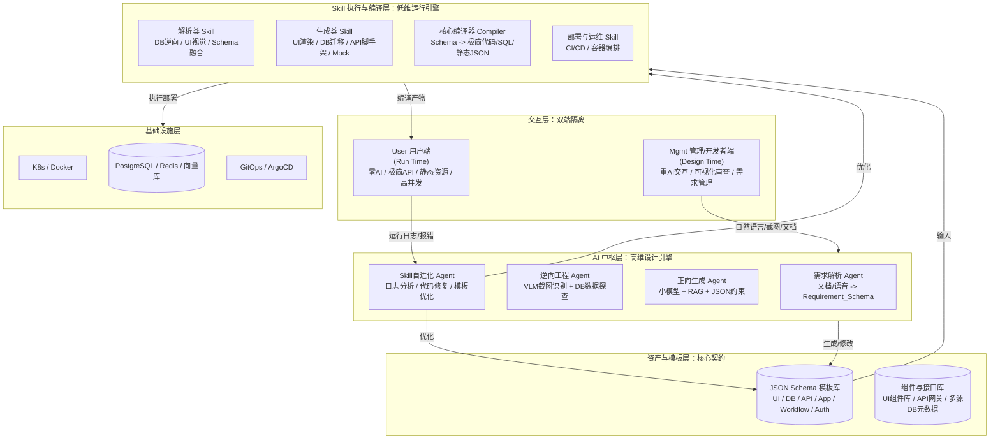
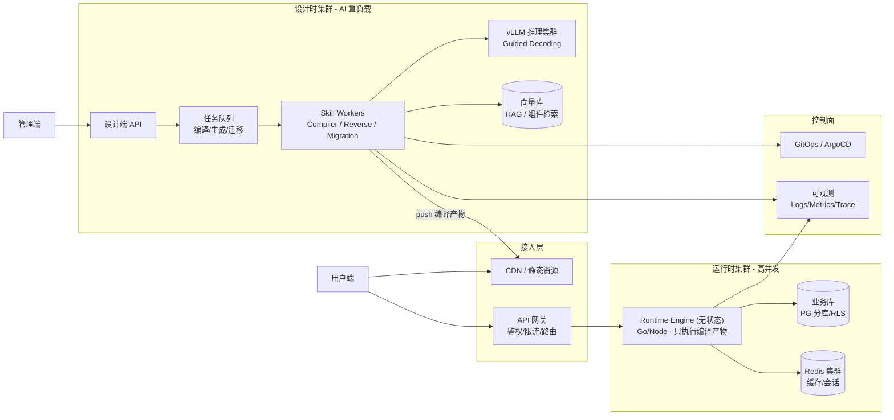
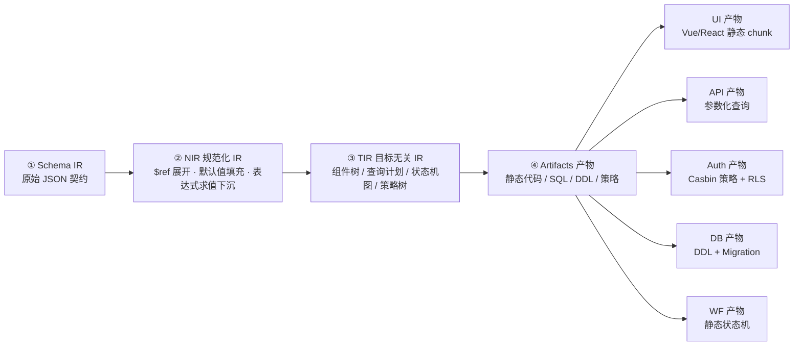
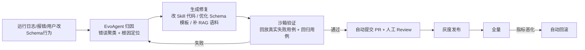
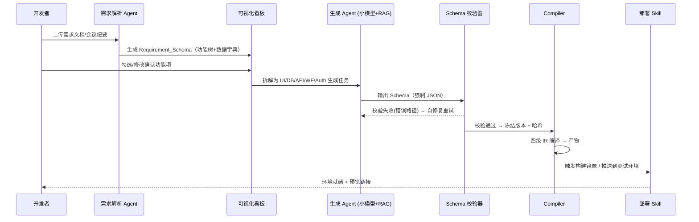

# AI驱动无代码智能应用平台（AI-Native No-Code Platform）技术开发方案

**文档版本**：V3.0
**编制日期**：2026年9月28日
**文档密级**：内部机密
**上游版本**：V2.0 (Final)

---

## 变更说明（V2.0 → V3.0）

| # | 变更类型 | 章节 | 说明 |
|---|---|---|---|
| 1 | 修复 | 全文 | 补全第四~九章标题层级与表格分隔符；修复 mermaid 代码块未闭合问题 |
| 2 | 强化 | 四、Schema 契约体系 | 原本仅有名词解释，现补充命名规范、版本策略、依赖图、校验管线，并给出**贯穿全文的"报销申请"完整示例** |
| 3 | 新增 | 五、编译器设计 | Compiler 从"一句话概念"扩展为**四级 IR 管线 + 内容寻址 + 增量编译 + 产物目录规范 + 编译正确性校验**（这是平台的核心壁垒，必须写透） |
| 4 | 强化 | 六、Skill 体系 | 补充 Skill 契约规范、SDK、生命周期、沙箱分级、自进化闭环的准入与回滚机制 |
| 5 | 新增 | 七、5~7 节 | 多租户隔离、可观测性、运行时引擎（零 AI 运行端） |
| 6 | 新增 | 九、非功能需求与 SLO | 性能、可用性、成本、扩展性量化指标 |
| 7 | 新增 | 十、安全与合规 | Prompt 注入、SQL 注入、多租户越权、等保与数据合规 |
| 8 | 强化 | 十二、路线图 | 每阶段补齐**交付物、验收标准、人力配置、阶段风险**，避免"只有目标没有验收" |
| 9 | 新增 | 十三、团队与资源 / 十四、成本模型 / 十五、MVP 定义 | 原方案缺失的落地要素 |
| 10 | 强化 | 十六、风险登记册 | 由 4 条扩展为结构化登记册（等级、触发信号、Owner） |

---

## 一、 执行摘要

本项目旨在打造一款下一代 **AI-Native（AI原生）无代码智能应用开发平台**。平台彻底颠覆了传统低代码平台"运行时动态解析JSON"的沉重架构，首创 **"高维设计，低维运行"** 的核心理念：

- **设计时（Design Time）**：用 AI + 复杂 JSON Schema 承载极高业务复杂度；
- **运行时（Run Time）**：由 Skill 引擎把 Schema **编译**为极简静态代码与 API，零 AI、零动态解析。

平台的两大差异化能力：

1. **正向生成**：一句话 / 一份需求文档 → 可运行的企业应用；
2. **逆向迁移**：旧系统数据库 + 页面截图 → 新平台应用（含数据迁移），直击企业存量系统重构的刚需。

并引入 **Skill 自进化机制**，使平台具备"越用越准"的长期复利。

### 1.1 目标客户与价值主张

| 客群 | 痛点 | 平台价值 |
|---|---|---|
| 中大型企业 IT 部门 | 存量系统技术债重、重构周期以年计 | 逆向迁移引擎，把重构从"重写"变为"编译" |
| 行业 ISV / 集成商 | 每个客户都要定制，交付人力线性增长 | 一次建模、多租户编译，交付边际成本趋近于零 |
| 业务部门（公民开发者） | 需求排期长，IT 资源永远不够 | 管理端自然语言 + 可视化审查，需求即交付 |

### 1.2 与传统低代码平台的核心差异

| 维度 | 传统低代码（宜搭/简道云/OutSystems 类） | 本平台 |
|---|---|---|
| 运行时形态 | 引擎动态解释 JSON 元数据 | **编译为静态代码/SQL**，运行时无元数据解析 |
| 性能天花板 | 受解释器性能限制，高并发需堆机器 | 接近手写代码，水平扩展线性 |
| 复杂度承载 | 复杂逻辑易退化为"写脚本" | Schema 契约 + Custom_Script 双层表达 |
| 旧系统迁移 | 基本靠人工重配 | 逆向工程 Agent 自动反推 |
| 系统演进 | 需人工修 Bug | Skill 自进化闭环自动修复 |

---

## 二、 核心架构哲学

本系统的架构设计严格遵循以下五条原则，这也是区别于传统低代码平台的核心壁垒：

> **1. JSON Schema 即绝对契约**
> AI 不直接生成易错的业务代码，而是强制输出符合严格校验的 JSON Schema。所有 UI、DB、API、流程、权限均通过 Schema 进行中间表示（IR）。
>
> **2. 高维设计，低维运行**
> - **管理端/配置端（Design Time）**：重 AI 交互、重复杂 Schema、允许一定延迟，追求业务表达的完整性。
> - **用户端/运行端（Run Time）**：零 AI 介入、极简 API、静态资源，追求极致并发与毫秒级响应。
>
> **3. Skill 编译化而非解释化**
> Skill 不仅是执行器，更是"编译器"。部署前把复杂 Schema 编译为极简产物，坚决不在高并发的用户端做沉重的动态解析。
>
> **4. 契约可编译、可验证、可回滚**
> 任何 Schema 必须通过机器校验才能进入编译；任何编译产物必须可追溯到唯一的 Schema 版本哈希；任何变更必须可一键回滚。**不可编译的 Schema 等于不存在的功能。**
>
> **5. 运行时零信任 AI**
> 用户端链路中不允许出现任何模型推理调用。AI 的所有产出在编译期冻结为静态资产，运行时只执行确定性逻辑。

---

## 三、 系统总体架构设计

系统采用分层架构，物理与逻辑上严格隔离"设计时"与"运行时"。

### 3.1 分层架构图



### 3.2 部署拓扑（物理视图）



**关键点**：运行时集群与设计时集群**物理隔离、独立扩缩容**。AI 推理负载的抖动绝不会影响用户端响应。

### 3.3 设计时 / 运行时边界

| 维度 | 设计时（Design Time） | 运行时（Run Time） |
|---|---|---|
| 用户 | 开发者 / 实施顾问 / 业务管理员 | 终端业务用户 |
| 有无 AI | 全链路 AI 参与 | **零 AI** |
| 数据形态 | 复杂 Schema（可能上百 KB） | 预编译查询 + 静态资源 |
| 延迟容忍 | 秒级 ~ 分钟级 | P95 < 100ms |
| 扩展方式 | 垂直扩容（GPU） | 水平扩容（无状态 Pod） |
| 失败影响 | 单次生成失败，可重试 | 影响线上业务，必须熔断降级 |

---

## 四、 核心规范：JSON Schema 契约体系

> 本章是平台**唯一的技术事实来源**。Schema 规范一旦冻结，AI 生成、Skill 编译、前端渲染、数据迁移全部围绕它展开。

### 4.1 Schema 分类与命名规范

| Schema 类型 | kind | 职责 |
|---|---|---|
| UI_Schema | `ui.page` | 页面结构、组件 Props、事件绑定、数据映射（Binding） |
| DB_Schema | `db.entity` | 表结构、索引、多数据源路由、数据特征约束 |
| API_Schema | `api.resource` | REST/GraphQL 接口、入参出参校验、鉴权规则 |
| Workflow_Schema | `wf.machine` | 轻量级状态机（节点、条件、动作），摒弃重型 BPMN |
| Auth_Schema | `auth.policy` | 多维 RBAC（组织-用户-角色-权限-数据范围） |
| App_Schema | `app.manifest` | 应用聚合根，引用上述所有 Schema，定义编译清单 |

**命名空间**：`{appId}.{module}.{entity}@{semver}`，例如 `expense.claim.ExpenseClaim@1.3.0`
**引用机制**：统一使用 `$ref: "{namespace}#/{jsonPointer}"`，编译期由解析器展开，避免上下文溢出。
**版本策略**：语义化版本。**Major** = 破坏性变更（需迁移脚本）；**Minor** = 兼容新增；**Patch** = 修复。

### 4.2 统一 Envelope 结构

所有 Schema 共享同一信封，便于通用校验器与工具链处理：

```json
{
  "$schema": "https://schema.platform.io/v1/ui.schema.json",
  "kind": "ui.page",
  "meta": {
    "namespace": "expense.claim.ClaimList",
    "version": "1.3.0",
    "displayName": "报销单列表",
    "owner": "team-finance",
    "tags": ["finance", "list"],
    "createdBy": "ai:gen-agent",
    "reviewedBy": "user:zhangsan"
  },
  "imports": [
    { "$ref": "expense.claim.ExpenseClaim@1.3.0#/entity" },
    { "$ref": "auth.policy.ClaimPolicy@1.0.0#/resources/claim" }
  ],
  "spec": { }
}
```

### 4.3 UI_Schema（含示例）

```json
{
  "kind": "ui.page",
  "meta": { "namespace": "expense.claim.ClaimList", "version": "1.3.0", "displayName": "报销单列表" },
  "imports": [{ "$ref": "expense.claim.ExpenseClaim@1.3.0#/entity" }],
  "spec": {
    "route": "/expense/claims",
    "layout": "admin.table-form",
    "dataSource": { "api": "expense.claim.Claim@1.3.0#/list" },
    "blocks": [
      {
        "type": "FilterBar",
        "props": { "collapsible": true },
        "fields": [
          { "name": "status", "widget": "select", "options": "$enum:ClaimStatus", "label": "状态" },
          { "name": "submitDate", "widget": "dateRange", "label": "提交日期" }
        ]
      },
      {
        "type": "DataTable",
        "props": { "rowKey": "id", "pageSize": 20, "stripe": true },
        "columns": [
          { "field": "claimNo", "title": "单号", "width": 160, "sortable": true },
          { "field": "applicantName", "title": "申请人", "width": 120 },
          { "field": "amount", "title": "金额", "format": "currency:CNY" },
          { "field": "status", "title": "状态", "format": "enumBadge:ClaimStatus" }
        ],
        "rowActions": [
          { "id": "view", "label": "查看", "event": "navigate($row.detailRoute)" },
          { "id": "approve", "label": "审批", "event": "openModal(ApprovalDialog)",
            "visibleWhen": "$auth.can('claim:approve') && $row.status == 'SUBMITTED'" }
        ],
        "toolbar": [
          { "id": "create", "label": "新建报销单", "event": "navigate('/expense/claims/new')",
            "visibleWhen": "$auth.can('claim:create')" }
        ]
      }
    ]
  }
}
```

**表达力边界（重要）**：`visibleWhen` / `event` 均为**受限表达式 DSL**（仅支持属性访问、比较、布尔运算、内置函数白名单），**不允许任意 JS**。复杂逻辑一律下沉到 Workflow_Schema 或 Custom_Script，保证编译器可静态分析、可编译。

### 4.4 DB_Schema（含示例）

```json
{
  "kind": "db.entity",
  "meta": { "namespace": "expense.claim.ExpenseClaim", "version": "1.3.0" },
  "spec": {
    "table": "expense_claim",
    "datasource": "primary",
    "tenantStrategy": "row_level",
    "columns": [
      { "name": "id", "type": "bigint", "pk": true, "generator": "snowflake" },
      { "name": "tenant_id", "type": "bigint", "notNull": true, "index": "tenant" },
      { "name": "claim_no", "type": "varchar(32)", "notNull": true, "unique": "uk_claim_no" },
      { "name": "applicant_id", "type": "bigint", "notNull": true, "fk": "employee.id" },
      { "name": "dept_id", "type": "bigint", "notNull": true, "index": "idx_dept" },
      { "name": "amount", "type": "decimal(18,2)", "notNull": true, "constraint": "amount > 0" },
      { "name": "status", "type": "varchar(16)", "notNull": true, "enum": "ClaimStatus", "default": "DRAFT" },
      { "name": "submitted_at", "type": "timestamptz", "nullable": true },
      { "name": "remark", "type": "text", "nullable": true, "sensitive": false }
    ],
    "indexes": [
      { "name": "idx_claim_query", "columns": ["tenant_id", "dept_id", "status", "submitted_at"] }
    ],
    "softDelete": true,
    "audit": { "createdBy": true, "createdAt": true, "updatedBy": true, "updatedAt": true }
  }
}
```

### 4.5 API_Schema（含示例）

```json
{
  "kind": "api.resource",
  "meta": { "namespace": "expense.claim.Claim", "version": "1.3.0" },
  "imports": [{ "$ref": "expense.claim.ExpenseClaim@1.3.0#/entity" }],
  "spec": {
    "basePath": "/api/expense/claims",
    "auth": { "mode": "jwt", "policyRef": "auth.policy.ClaimPolicy@1.0.0" },
    "endpoints": [
      {
        "id": "list", "method": "GET", "path": "",
        "query": { "status": "ClaimStatus?", "deptId": "long?", "page": "int=1", "size": "int=20" },
        "dataScope": "$auth.scope('claim','read')",
        "response": { "type": "page<ClaimVO>" }
      },
      {
        "id": "create", "method": "POST", "path": "",
        "permission": "claim:create",
        "body": { "claimNo": "string", "amount": "decimal", "items": "ClaimItemDTO[]" },
        "validate": { "items": "minLength(1)" },
        "response": { "type": "ClaimVO" }
      },
      {
        "id": "submit", "method": "POST", "path": "/{id}/submit",
        "permission": "claim:update",
        "precondition": "$row.status == 'DRAFT' && $row.applicantId == $user.id",
        "emits": "wf.machine.ClaimFlow@1.2.0#/event/SUBMIT",
        "response": { "type": "ClaimVO" }
      }
    ]
  }
}
```

### 4.6 Workflow_Schema（状态机示例）

```json
{
  "kind": "wf.machine",
  "meta": { "namespace": "expense.claim.ClaimFlow", "version": "1.2.0" },
  "spec": {
    "initial": "DRAFT",
    "states": {
      "DRAFT":     { "on": { "SUBMIT": "DEPT_REVIEW" } },
      "DEPT_REVIEW": {
        "assignee": "$row.deptManagerId",
        "sla": "48h",
        "on": {
          "APPROVE": [{ "guard": "$row.amount <= 50000", "target": "FINANCE_REVIEW" },
                      { "target": "CEO_REVIEW" }],
          "REJECT": "REJECTED"
        }
      },
      "FINANCE_REVIEW": { "assignee": "$role('FINANCE')", "on": { "APPROVE": "APPROVED", "REJECT": "REJECTED" } },
      "CEO_REVIEW":     { "assignee": "$role('CEO')",     "on": { "APPROVE": "APPROVED", "REJECT": "REJECTED" } },
      "APPROVED": { "on": { "PAY": "PAID" }, "action": "notify($row.applicantId, '已审批通过')" },
      "REJECTED": { "final": true },
      "PAID":     { "final": true }
    }
  }
}
```

**实现要点**：Workflow 无独立流程引擎。用户点"审批" → 调用**通用审批 API** → 后端 Skill 依据编译后的静态状态机（O(1) 查表）计算下一状态 → 直接 UPDATE 业务表 + 写审批流水。**零流程引擎开销**。

### 4.7 Auth_Schema（RBAC + 数据范围示例）

支持自然语言输入："让财务小李只能看本部门 5 万以下报销单"，AI 转化为：

```json
{
  "kind": "auth.policy",
  "meta": { "namespace": "auth.policy.ClaimPolicy", "version": "1.0.0" },
  "spec": {
    "model": "rbac_with_data_scope",
    "roles": [
      { "name": "APPLICANT", "permissions": ["claim:create", "claim:read:own", "claim:update:own"] },
      { "name": "DEPT_MANAGER", "permissions": ["claim:read:dept", "claim:approve:dept"] },
      { "name": "FINANCE", "permissions": ["claim:read:dept", "claim:read:amount<=50000", "claim:approve:finance"] }
    ],
    "dataScopes": [
      { "role": "APPLICANT", "resource": "claim", "predicate": "applicant_id = $user.id" },
      { "role": "DEPT_MANAGER", "resource": "claim", "predicate": "dept_id = $user.deptId" },
      { "role": "FINANCE", "resource": "claim", "predicate": "dept_id = $user.deptId AND amount <= 50000" }
    ]
  }
}
```

**编译结果**：`model.conf` + `policy.csv`（Casbin）→ 编译期固化为静态策略文件；`dataScopes.predicate` 直接编译为 **SQL WHERE 谓词注入**（行级权限下沉到数据库，绝不在应用层做内存过滤）。

### 4.8 Schema 校验管线

```
AI 产出草稿
   ↓ ① 语法校验     JSON Schema Draft 2020-12 校验器（结构/类型/枚举）
   ↓ ② 语义校验     引用完整性（$ref 可解析）、命名空间唯一性、枚举一致性
   ↓ ③ 业务规则校验 金额>0、必填、状态机可达性（无孤儿状态）、权限引用有效
   ↓ ④ 可编译性校验 表达式 DSL 是否在白名单内、目标 Profile 是否支持该组件
   ↓ ⑤ 兼容性校验   与上一版本 diff，识别破坏性变更并强制生成迁移脚本
   ↓ 通过 → 冻结为不可变版本 + 内容哈希 → 进入编译队列
   ↓ 失败 → 打回 AI 上下文（携带错误路径），最多 3 轮自修复，仍失败转人工
```

---

## 五、 编译器（Compiler）设计 —— 平台核心壁垒

> 编译器是"高维设计，低维运行"的物理实现，也是整个方案**技术风险最高、必须最先攻坚**的模块。

### 5.1 四级 IR 编译管线



| 层级 | 输入 | 输出 | 关键工作 |
|---|---|---|---|
| ① Schema IR | AI 生成的 JSON | 校验通过的 Schema | 只做校验，不做变换 |
| ② NIR | Schema IR | 展平、自包含的 IR | 展开所有 `$ref`、填充默认值、解析 `$enum`、内联 Component 库定义 |
| ③ TIR | NIR | 目标语言无关模型 | UI → 组件树；API → 查询计划（AST）；Auth → 谓词树；WF → 有向图 |
| ④ Artifacts | TIR | 可部署产物 | 模板渲染（Go template / ts-morph）、代码格式化、SourceMap |

**分层的意义**：新增一种目标端（如小程序、Flutter）只需实现一个新的 TIR → Artifacts 后端，NIR 及以上全部复用。

### 5.2 内容寻址与增量编译

```
artifactHash = sha256( NIR_hash + compilerVersion + targetProfile + 依赖Schema哈希集 )
```

| 机制 | 说明 | 收益 |
|---|---|---|
| 内容寻址 | 产物按哈希命名，相同输入必得相同产物 | 构建可缓存，跨应用复用 |
| 增量编译 | 只重编译受变更 Schema 影响的子图 | 大应用全量编译从 10min 降至秒级 |
| 依赖图 | Schema 间 `$ref` 构成 DAG，拓扑排序确定编译顺序 | 并行编译无依赖节点 |
| 局部预览 | 单页面独立编译，无需全量构建 | 设计端"修改即预览"体验 |

### 5.3 编译产物规范

```
dist/
├── manifest.json                 # 编译清单：版本、哈希、依赖、编译时间
├── ui/
│   ├── routes.json               # 静态路由表（编译期确定）
│   ├── pages/
│   │   ├── claim-list.7f3a9c.js     # 内容寻址 chunk（数据绑定已内联为静态字段引用）
│   │   └── claim-form.2b81de.js
│   └── assets/                   # 静态资源 + CDN manifest
├── api/
│   ├── openapi.json              # 编译期生成，仅供文档/联调
│   └── queries/
│       └── claim.list.4c19a7.plan.json   # 预编译参数化查询计划
├── db/
│   ├── schema.sql                # DDL
│   ├── rls.sql                   # 行级权限策略
│   └── migrations/V1.2__1.3.sql  # 版本迁移脚本
├── auth/
│   ├── model.conf                # Casbin model
│   └── policy.csv                # 静态策略
└── workflow/
    └── claim-flow.a3f8b2.fsm.json    # 静态状态机（运行时 O(1) 查表）
```

### 5.4 运行时引擎（编译产物的执行者）

- **不解析 Schema**：Runtime 只读取 `manifest.json` 做能力声明，业务逻辑全部在产物代码中。
- **无状态**：所有状态在 PG/Redis，Pod 可任意扩缩。
- **查询执行器**：读取 `*.plan.json`，按编译期确定的字段列表与 WHERE 谓词组装参数化 SQL。**运行时不做字段推导、不做权限内存过滤**。
- **降级策略**：编译产物缺失 → 返回静态兜底页 + 告警；DB 慢查询 → 熔断 + 缓存旧结果。

### 5.5 编译正确性保障

| 手段 | 说明 |
|---|---|
| 双跑对比 | 同一 Schema 分别走"解释执行"与"编译执行"，比对输出一致性（Golden Case 回归） |
| 编译期测试生成 | 由 API_Schema 自动生成契约测试用例，编译后立即跑通 |
| 产物快照测试 | 产物与上一版本 diff，意外变更需人工确认 |
| 强类型模板 | 模板使用强类型 IR，编译期类型错误直接中断构建 |

---

## 六、 Skill 体系与运行时

### 6.1 Skill 分类

| 类别 | Skill | 输入 | 输出 | 幂等 | 超时 |
|---|---|---|---|---|---|
| 解析类 | DB Reverse | 旧库连接串 | DB_Schema + 探查报告 | 是 | 5min |
| 解析类 | UI Vision | 截图（多张） | UI_Schema 草稿 | 是 | 2min |
| 解析类 | Schema Merge | UI_Schema + DB_Schema | App_Schema | 是 | 30s |
| 生成类 | UI Render | UI_Schema | 前端代码/产物 | 是 | 60s |
| 生成类 | API Scaffold | API_Schema | 接口代码 + OpenAPI | 是 | 60s |
| 生成类 | DB Migrate | DB_Schema diff | DDL + 迁移脚本 | 是 | 60s |
| 生成类 | Mock Gen | API_Schema | Mock 服务 | 是 | 10s |
| 编译类 | **Compiler** | NIR | Artifacts | 是 | 见 5.1 |
| 部署类 | Deploy | Artifacts | 环境部署结果 | 否（可回滚） | 10min |

### 6.2 Skill 契约规范（SDK）

每个 Skill 必须声明：

```yaml
name: db-reverse
version: 1.2.0
category: parse
entry: ./src/index.ts
permissions: [ "net:db:read", "fs:none" ]
inputs:  { connection: "DbConnection", tables: "string[]?" }
outputs: { schema: "DB_Schema", profiling: "ProfilingReport" }
sandbox: strict          # strict | normal | trusted
resources: { cpu: "2", mem: "4Gi", timeout: "300s" }
idempotent: true
```

### 6.3 Skill 生命周期

```
草稿 → 单元测试 → 沙箱集成测试 → 灰度(10%租户) → 全量 → (异常) 秒级回滚
```

### 6.4 Skill 自进化机制（带安全护栏）



**护栏（必须有，否则等于给系统装了个自动埋雷的机器人）**：

1. 自进化改动**只允许**改 Skill 代码 / Prompt / RAG 语料，**禁止**直接改已冻结的业务 Schema；
2. 沙箱必须回放历史失败用例，且回归用例通过率 100% 才放行；
3. 一律走 PR + 人工 Review，不做全自动合并（成熟后可按类别放开）；
4. 全量后 30 分钟内监控核心指标，异常自动回滚；
5. 每次自进化留存完整 diff 与效果对比，形成可审计的进化档案。

---

## 七、 核心模块详细设计

### 7.1 需求收集与管理

- AI 解析需求文档/会议纪要/语音 → 生成结构化 `Requirement_Schema`（功能树 + 数据字典 + 角色清单）；
- 开发者在可视化看板中增删改确认（"做选择题"而非"写文档"）；
- 确认后自动拆解为 UI/DB/API/Workflow/Auth 的 Schema 生成任务，进入并行生成队列；
- 需求项 ↔ Schema ↔ 编译产物 ↔ 部署环境 **四向可追溯**。

### 7.2 流程审核（Workflow）

见 4.6。核心原则：**数据库即流程引擎**。审批记录独立表 `wf_instance` + `wf_task`，但状态推进逻辑由编译后的静态状态机驱动，无独立引擎进程。

### 7.3 用户权限（Auth）

见 4.7。三层落地：
- **功能权限**：Casbin 静态策略，运行时 matcher 求值（微秒级）；
- **数据权限**：编译为 SQL 谓词注入，**在数据库层完成过滤**；
- **字段权限**：编译期决定 VO 字段裁剪，敏感字段不出库。

### 7.4 旧系统逆向迁移引擎

| 组件 | 职责 | 关键技术 |
|---|---|---|
| DB Reverse Skill | 逆向表结构 + 数据探查（Data Profiling），推断字段业务含义 | 元数据读取 + ydata-profiling + 值域/命名规则推断 |
| UI Vision Skill | 分析旧系统截图，识别布局、组件类型、表单字段 | 多模态大模型 + screenshot-to-code 的 Prompt 工程 |
| Schema Merge Skill | UI 字段与 DB 字段语义匹配与对齐 | 字段名相似度 + 类型匹配 + 值域匹配 + Embedding 语义匹配 |
| 可视化审查工作台 | 左旧资产 / 中新连线 / 右新预览，人工微调即生效 | 实时局部编译预览 |

**暗逻辑补全**：截图与 DB 均无法推断的业务规则（如特殊财务公式），系统主动向用户提问补全，或落入 `Custom_Script` 代码块兼容。

### 7.5 多租户隔离

| 层 | 策略 | 适用场景 |
|---|---|---|
| 数据 | 共享库 + `tenant_id` 行级隔离（RLS） | 中小租户，成本最优 |
| 数据 | 独立 Schema（同库不同 schema） | 中型租户，隔离性提升 |
| 数据 | 独立库 / 独立实例 | 大客户、强合规场景 |
| 编译产物 | 按 `tenantId + appId` 命名空间隔离 | 全场景 |
| 模型 | 共享推理集群，Prompt 与 RAG 语料按租户隔离 | 全场景 |
| 配额 | 租户级 token 配额、编译次数配额、存储配额 | 全场景 |

### 7.6 可观测性

| 维度 | 指标 | 工具 |
|---|---|---|
| 用户端 | QPS、P50/P95/P99、错误率、首屏 FCP | Prometheus + Grafana + Sentry |
| 编译链路 | 编译时长、缓存命中率、失败率、失败原因分布 | OpenTelemetry Trace |
| AI 链路 | Token 消耗、JSON 一次校验通过率、重试轮次、P95 生成时长 | 自建 AI 网关埋点 |
| 业务 | 各应用活跃用户、Schema 变更频次、自进化触发次数 | 数仓 + BI |
| 告警 | 运行时错误率 > 1%、编译失败率 > 10%、Token 日消耗超预算 80% | Alertmanager |

---

## 八、 核心工作流设计

### 8.1 需求到交付流（AI 驱动研发）



### 8.2 逆向迁移流（旧系统重构）

1. **资产接入**：配置旧 DB 只读连接，上传核心页面截图（建议覆盖所有典型页面类型）；
2. **逆向解析**：DB Reverse Skill 提取表结构与数据特征；UI Vision Skill 识别页面布局与字段；
3. **智能融合**：Schema Merge Skill 语义对齐，生成初版 `App_Schema` 与置信度评分；
4. **人工审查**：可视化审查工作台，**低置信度项优先呈现**，用户微调即触发局部重编译预览；
5. **编译与部署**：Compiler 生成极简产物 → Data Migration Skill 迁移旧数据（全量 + 增量双阶段）→ 灰度切流 → 回滚预案就绪。

### 8.3 Skill 自进化流

见 6.4。

---

## 九、 非功能需求与 SLO

| 类别 | 指标 | 目标值 | 说明 |
|---|---|---|---|
| 性能 | 运行时 API P95 | ≤ 100ms | 同机房，编译产物直查 DB |
| 性能 | 运行时 API P99 | ≤ 300ms | — |
| 性能 | 用户端首屏 FCP | ≤ 1.2s | 静态资源 CDN |
| 性能 | 单页编译耗时 | ≤ 3s | 增量编译 |
| 性能 | 全应用编译耗时 | ≤ 60s | 并行 + 缓存 |
| 性能 | 单页 Schema 生成耗时 | ≤ 20s | 小模型 + 缓存 RAG |
| 质量 | Schema 一次校验通过率 | ≥ 92% | 反映 Prompt 与约束解码质量 |
| 质量 | 编译成功率 | ≥ 99.5% | 失败必须可归因 |
| 可用性 | 运行时服务可用性 | 99.9% | 设计时服务 99.5% 即可 |
| 可用性 | 故障恢复 RTO / RPO | 5min / 0 | 编译产物不可变，回滚即恢复 |
| 容量 | 单应用支持页面数 | ≥ 300 | — |
| 容量 | 单租户并发用户 | ≥ 5000 | 水平扩展 |
| 成本 | Schema 生成单应用 Token 成本 | ≤ 目标预算 | 缓存 + 分块生成控制 |
| 成本 | 编译缓存命中率 | ≥ 70% | 直接决定编译成本 |
| 安全 | 越权访问拦截率 | 100% | 功能 + 数据 + 字段三层 |
| 兼容 | 产物可回滚版本数 | ≥ 20 | 按哈希保留 |

---

## 十、 安全与合规设计

| 风险面 | 威胁 | 防护措施 |
|---|---|---|
| Prompt 注入 | 用户文档中嵌入"忽略上述指令"导致生成恶意 Schema | 输入隔离与转义、指令与数据分离、生成结果必经 Schema 校验（校验器是最终防线） |
| SQL 注入 | Schema 中表达式拼接 SQL | 编译期强制参数化，禁止字符串拼接 SQL；表达式 DSL 白名单 |
| 越权 | 数据范围配置错误导致跨部门/跨租户读数据 | 数据权限**下沉为 SQL 谓词**（不依赖应用层）；编译期做权限引用完整性校验；上线前自动跑越权探针测试 |
| 密钥泄露 | 旧库连接串、模型 Key 明文存储 | KMS 加密存储、运行时注入、审计访问日志、连接串不落盘 |
| 数据合规 | 敏感数据出境/越权导出 | 字段级脱敏（编译期裁剪）、导出行数限制、审计留痕 |
| 供应链 | Skill 市场引入恶意 Skill | Skill 沙箱隔离（strict 模式无网络）、权限最小化声明、上架人工审核、签名校验 |
| 模型风险 | 小模型生成合规敏感内容 | 输入输出双向内容过滤 + 租户级策略 |
| 审计 | 无法追溯"谁改了什么" | Schema 版本不可变 + 变更留痕（AI 生成 / 人工修改可区分）+ 编译产物溯源 |

**合规目标**：等保三级（企业级交付场景）、个人信息保护法/数据安全法基本要求、敏感字段默认加密与脱敏。

---

## 十一、 技术栈与开源组件推荐

| 模块 | 推荐技术/开源项目 | 选型理由 |
|---|---|---|
| AI 模型推理 | vLLM / Ollama | 高吞吐，原生支持 Guided Decoding，完美实现强制 JSON Schema 输出，解决小模型幻觉 |
| Agent 编排 | LangGraph | 构建复杂、有状态 Agent 工作流的最佳框架，适合多步推理与校验闭环 |
| 前端 Schema 渲染 | Formily（阿里开源） | 最强大的 Schema 驱动表单/页面渲染引擎，契合"后端定义复杂 Schema，前端直接渲染"理念 |
| 状态机/工作流 | XState | 轻量级状态机，支持 JSON 配置，替代沉重的传统 BPM 引擎 |
| 权限控制 | Casbin | 支持 RBAC/ABAC 等多种模型，将 Auth_Schema 转化为 Policy，高性能校验 |
| 数据库 ORM | Prisma (Node) / SQLAlchemy (Py) | 根据 DB_Schema 自动生成类型安全客户端与 API 基础代码 |
| 数据探查 | ydata-profiling | 一键生成详细数据探查报告，用于旧系统 DB 逆向分析 |
| 视觉逆向 | screenshot-to-code | 参考其 VLM Prompt 工程，将截图转化为初步 UI 结构描述 |
| **Schema 校验**（补充） | Ajv / JSON Schema 2020-12 | 编译管线 ① 级校验的事实标准，性能与生态最优 |
| **代码生成模板**（补充） | ts-morph / Go text/template | 产物级模板渲染，支持类型安全的 AST 操作与格式化 |
| **运行时引擎**（补充） | Go（推荐）/ Node + Fiber | 运行时追求极致并发与低内存，Go 更适合无状态高并发网关 |
| **可观测**（补充） | OpenTelemetry + Prometheus + Grafana | 编译链路与运行时统一 Trace，定位"生成→编译→运行"全链路问题 |
| **任务队列**（补充） | Temporal / BullMQ | 编译、生成、数据迁移均为长任务，需要可重试、可观测的编排 |
| **向量检索**（补充） | pgvector（起步）/ Milvus | RAG 语料与组件检索，pgvector 可与业务库共用降低运维成本 |

---

## 十二、 项目实施路线图（Roadmap）

### Phase 1：核心引擎与 MVP（第 1–3 个月）

| 项 | 内容 |
|---|---|
| 目标 | 跑通"一句话 → JSON Schema → 基础 CRUD 应用"闭环 |
| 关键任务 | 定义基础 Schema 规范（UI/DB/API）；开发基础正向生成 Skill；接入小模型实现强制 JSON 输出；实现需求解析 Agent；搭建 Schema 校验管线 |
| 交付物 | Schema 规范 v1.0；AI 生成服务；一套可运行的单表 CRUD 应用 |
| 验收标准 | 输入一句话，5 分钟内生成可运行的单表增删改查应用，一次成功率 ≥ 80% |
| 人力 | 架构 1 + AI 2 + 后端 2 + 前端 1 = 6 人 |
| 阶段风险 | 小模型 JSON 稳定性不足 → 提前验证 Guided Decoding，准备多模型兜底 |

### Phase 2：逆向工程与"编译"机制（第 4–6 个月）

| 项 | 内容 |
|---|---|
| 目标 | 实现旧系统迁移，落地"高维设计，低维运行"的编译机制 |
| 关键任务 | 开发逆向解析 Skill（DB 探查 / 截图识别 / Schema 融合）；开发可视化审查工作台；**核心攻坚 Compiler**（四级 IR、内容寻址、增量编译）；建立双跑对比回归体系 |
| 交付物 | 逆向迁移引擎；Compiler v1.0；可视化审查工作台；编译产物规范 |
| 验收标准 | 上传旧系统截图 + DB 生成新应用，字段对齐准确率 ≥ 85%；用户端访问的是编译后产物，无 Schema 动态解析 |
| 人力 | +编译器/后端 2 + 前端 1 + 测试 1 = 10 人 |
| 阶段风险 | **编译器复杂度被低估**（本方案最大风险）→ 第一周即冻结 TIR 规范，采用"先窄后宽"策略：先支持 5 类核心组件，再逐步扩展 |

### Phase 3：复杂业务与自进化（第 7–9 个月）

| 项 | 内容 |
|---|---|
| 目标 | 支持企业级复杂逻辑，系统具备自我迭代能力 |
| 关键任务 | 实现轻量级 Workflow_Schema 与多维 Auth_Schema；上线 Skill 自进化 Agent（含沙箱与灰度） |
| 交付物 | 工作流与权限编译能力；自进化闭环 |
| 验收标准 | 生成含多级审批流 + 细粒度数据权限的多表应用；自进化可自动修复 ≥ 50% 的简单错误且零线上事故 |
| 人力 | +AI 1 + 后端 1 = 12 人 |
| 阶段风险 | 权限配置错误导致越权 → 上线前自动化越权探针测试 |

### Phase 4：生态开放与商业化（第 10–12 个月）

| 项 | 内容 |
|---|---|
| 目标 | 构建开发者生态，支持多租户与高可用 |
| 关键任务 | 开放 Skill 开发者市场（SDK + 审核流程）；完善多租户隔离、计费、监控告警体系；压测与容量规划 |
| 交付物 | Skill 市场；多租户与计费系统；可观测与告警体系 |
| 验收标准 | 单租户 5000 并发下 P95 ≤ 100ms；Skill 市场上架 ≥ 20 个第三方 Skill |
| 人力 | +DevOps 1 + 产品 1 = 14 人 |
| 阶段风险 | 第三方 Skill 引入安全风险 → 严格沙箱 + 人工审核 + 签名 |

---

## 十三、 团队与资源

| 角色 | 人数 | 职责 |
|---|---|---|
| 架构师 | 1 | Schema 规范、IR 设计、Compiler 架构 |
| AI / Agent 工程师 | 3 | Prompt 工程、约束解码、RAG、自进化 Agent |
| 编译器 / 后端工程师 | 3~4 | Compiler、Skill 运行时、API 网关、逆向引擎 |
| 前端工程师 | 2~3 | 管理端、Schema 渲染、可视化审查工作台 |
| 测试工程师 | 1 | Schema 校验测试、双跑对比、越权探针 |
| DevOps | 1 | K8s、GitOps、可观测、模型部署 |
| 产品经理 | 1 | 需求 Schema、可视化看板、生态设计 |
| **合计** | **12~14 人** | — |

**硬件资源**：GPU 推理集群（建议 A100/H20 × 2 起，Phase 1 可用云按量）、K8s 集群、PG + Redis + 向量库、对象存储（产物与截图）。

---

## 十四、 成本模型

| 成本项 | 主要驱动 | 优化手段 |
|---|---|---|
| 模型推理 | Schema 生成 Token 量、重试轮次 | RAG 做"填空题"降低 Token；分块生成；结果缓存 |
| 编译 | 编译频次、缓存命中率 | 内容寻址缓存；增量编译；局部预览不改全量 |
| 存储 | 产物版本、截图、审计日志 | 产物哈希去重；日志分级保留；冷数据归档 |
| 运行 | QPS、Pod 数 | 产物极简 → 单 Pod 承载更高 QPS；静态资源走 CDN |

**关键杠杆**：**编译缓存命中率**。命中率每提升 10%，编译成本近似线性下降，同时改善编辑器"修改即预览"体验。

---

## 十五、 MVP 定义（最小可用版本）

Phase 1 的 MVP 必须**严格限定边界**，避免范围蔓延：

| 项 | MVP 范围 | 明确不做（延后） |
|---|---|---|
| 应用形态 | 单表 / 双表 CRUD | 多级审批流 |
| UI 组件 | 10 个核心组件（表格、表单、筛选、弹窗、详情、日期、下拉、上传、富文本、布局） | 自定义组件、图表 |
| 权限 | 角色级功能权限 | 数据范围、字段权限 |
| 流程 | 无 | 状态机 |
| 逆向 | 无 | DB 逆向、截图识别 |
| 编译 | 只做 UI 编译 + 静态查询 | 增量编译、缓存 |
| 部署 | 单租户、单环境、手动触发 | 多租户、灰度、自动回滚 |
| 验收 | 一句话 → 5 分钟内可运行应用，一次成功率 ≥ 80% | — |

---

## 十六、 风险评估与应对策略

| ID | 风险点 | 类别 | 概率 | 影响 | 等级 | 应对策略 | 触发信号 | Owner |
|---|---|---|---|---|---|---|---|---|
| R1 | 小模型幻觉与格式错误 | 技术 | 高 | 中 | **高** | ① 放弃直接生成大 JSON，改为分块生成；② 强制 vLLM Guided Decoding 约束解码；③ 引入 RAG 让小模型做"填空题"；④ 校验失败携带错误路径自修复，最多 3 轮 | 一次校验通过率 < 85% | AI 负责人 |
| R2 | **编译器复杂度失控** | 技术 | 高 | 高 | **极高** | ① Phase 2 重兵投入，Phase 1 即冻结 TIR 规范；② "先窄后宽"：先支持 5 类组件再扩展；③ 双跑对比回归体系保证语义等价 | 单页编译 > 10s 或组件扩展成本非线上升 | 架构师 |
| R3 | 运行时性能瓶颈 | 技术 | 中 | 高 | **高** | 坚守"编译"底线：推送到用户端的必须是编译后极简产物；建立编译产物准入检查（禁止运行时元数据解析） | 运行时出现任何 Schema 解析耗时 | 架构师 |
| R4 | 逆向工程"暗逻辑"丢失 | 业务 | 高 | 中 | **高** | ① Schema 引入 `Custom_Script` 兼容旧逻辑；② AI 分析数据异常时主动提问补全；③ 提供置信度评分，低置信度项优先人工确认 | 用户反馈"生成的不是这个规则"频次上升 | 逆向负责人 |
| R5 | Skill 自进化引入新 Bug | 技术 | 中 | 高 | **高** | ① 沙箱测试 + 失败用例回放；② 禁止自改业务 Schema；③ PR + 人工 Review；④ 灰度 + 指标恶化自动回滚 | 灰度期错误率上升 > 0.5% | AI 负责人 |
| R6 | 权限配置错误导致越权 | 安全 | 中 | 极高 | **极高** | 数据权限下沉 SQL 谓词；编译期权限引用校验；上线前自动越权探针测试 | 探针测试出现任何越权 | 安全负责人 |
| R7 | Prompt 注入导致生成恶意 Schema | 安全 | 中 | 高 | **高** | 输入隔离、指令/数据分离；生成结果必经 Schema 校验（最终防线） | 校验器拦截到含 SQL 拼接意图的表达式 | 安全负责人 |
| R8 | 模型成本失控 | 成本 | 中 | 中 | 中 | Token 配额、RAG 缓存、编译缓存；租户级预算告警 | 日消耗超预算 80% | 产品负责人 |
| R9 | 关键人才依赖 | 组织 | 中 | 中 | 中 | Compiler 与 Schema 规范强制文档化 + 结对开发；核心模块至少 2 人可接手 | 关键模块单点 Owner | 技术负责人 |

---

## 十七、 结语与下一步行动

本方案构建的不仅是一个无代码工具，而是一个 **"基于 Schema 编译的 AI-Native PaaS"**。

通过将开发者从"代码工人"重塑为"资产工程师"，把复杂业务逻辑收敛于 JSON Schema，并将运行时性能做到极致，平台将彻底打破传统软件开发的效率瓶颈。尤其在**旧系统逆向迁移**这一企业级刚需场景下，具备极高的商业壁垒与市场价值。

### 下一步行动（未来 4 周）

| 周 | 行动 | 产出 |
|---|---|---|
| W1 | 冻结 Schema 规范 v0.1（UI / DB / API 三件套）+ 确定 TIR 分层边界 | 规范文档 + 评审通过 |
| W2 | 搭建 vLLM + LangGraph 最小生成闭环，验证 Guided Decoding 强制 JSON 输出的稳定性 | 一次校验通过率基线数据 |
| W3 | 调研 Formily 极限渲染能力 + 验证 10 个核心组件在 Schema 驱动下的表现 | 组件可行性报告 |
| W4 | 跑通"一句话 → Schema → 渲染页面"端到端 Demo（可含 Mock 数据） | Demo + Phase 1 详细排期 |

**启动门槛（Gate）**：W2 的"一次校验通过率"若 < 80%，Phase 1 的排期必须重估，优先解决约束解码与 Prompt 工程问题，而不是继续扩大功能范围。
