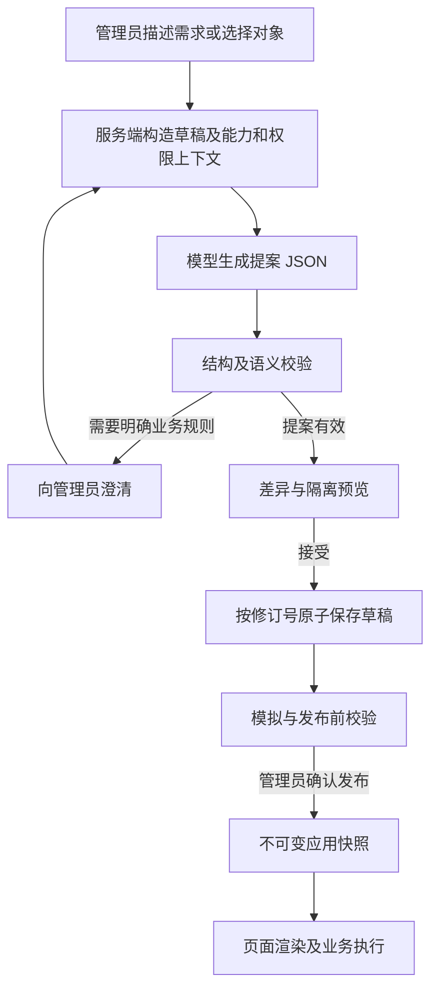

# AI 应用设计开发蓝图

2026-10-20 开发顺序更新：后续按 [分阶段闭环交付计划](closed-loop-delivery-plan.md) 和 [开发与版本规范](development-and-versioning.md) 执行，先保护现有课表与多应用链路，再做简单表单及单级请假真实闭环，之后扩展创建方式。本文保留技术蓝图，不要求一次实现全部通用能力。

2026-10-20 补充：多应用阶段采用 [应用类型扩展协议与多应用配置隔离](application-type-extension.md)，其中类型注册、实例封装、存储隔离和迁移方案优先于本文早期候选设计。继续复用现有发布中心，不并行建立 design_application/design_release 发布体系；表单/流程内部协议保持有效。

版本：1.0.0 草案。通用运行时及请假执行模块尚未开发；课表专用已实现 AI 模型配置、生成、校验、预览和接受草稿。既有课表 MVP 保持运行；Docker 部署继续作为后续事项。

## 与最初计划对齐

优先验证 `plan.md` 第 1 章的两项价值：管理员无需研发完成受控配置，以及低成本解决学生高频请求。管理端 AI 设计是用户后续确认的扩展，先用于现有课表的展示与规则配置，再推广到新应用；通用表单、流程和视图协议保留为后续蓝图，不作为本期课表发布的前置依赖。详细对应见 [MVP 目标与实施门槛](mvp-design-alignment.md)。

第一阶段采用 `course-context.schema.json` 和 `course-proposal.schema.json`，直接描述现有 DisplayConfig 的受控修改。先实现“把地点改名、隐藏教师、调整列顺序、增加合法课表别名”这一可观察闭环，不要求把课表迁移到通用应用模型。

学生运行链路保持规则优先、已发布快照驱动，不调用设计模型。管理端设计模型独立启用、预算和审计；关闭设计 AI 后仍能手工配置、发布和查询。管理端模型费用单独统计，不计入学生规则命中的每次查询成本。

## 目标与设计入口

管理员描述应用需求，AI 生成数据、表单、流程、视图、权限和页面的结构化草稿。管理员可以继续对话，或点击字段/节点使用属性面板精确修改。全程不要求拖拽。运行端读取明确发布的 JSON 定义，不依赖模型临时生成执行逻辑。

设计界面左侧为应用结构，中间为表单/页面预览或只读流程图，右侧为对话和属性。切换选中对象后，显示本次请求的作用范围。查看修改前后差异、接受、拒绝、撤销均是独立操作；草稿自动预览不等于发布。界面始终区分“AI 正在生成”“待澄清”“待接受”“草稿已保存”“校验阻塞”“已发布”。

## 设计链路

参考契约为 [应用 JSON 标准](../../packages/contracts/application-design/v1/README.md)，模型行为遵循 [AI 生成规范](ai-generation-spec.md)。系统端保有校验、授权、动作执行和版本控制，模型只提供设计候选。

## 模块与职责

| 模块 | 职责 | 建议位置 |
| --- | --- | --- |
| 设计协议 | Schema、契约、版本及兼容规则 | `packages/contracts/application-design/v1` |
| 组件与能力目录 | 白名单属性、字段类型、已实现动作、关系和 scope | 后续 `apps/api/app/modules/designer/catalog` |
| 设计服务 | 草稿、提案、接受、撤销、差异与校验 | 后续 `apps/api/app/modules/designer` |
| AI 适配 | 上下文、模型调用、结构化输出、有限修正 | 后续 designer 内独立适配模块 |
| 表单与视图运行时 | JSON 到受控 React 组件，前端校验和布局 | 后续 `apps/web/src/designer` 与 `runtime` |
| 请假业务 | 持久化申请、任务、合法命令与事务 | 后续独立 leave 业务模块 |
| 流程运行时 | 白名单节点及条件、任务路由、版本绑定 | 首个场景在 leave 模块内实现，再据复用需要提取 |

不提前拆分微服务或引入独立流程引擎。有限流程能否满足后续真实场景后再决定是否采用 BPMN 引擎；不能把流程图生成当作执行引擎完成。

## 与现有课表系统的衔接

当前 DisplayConfig 是单一课表展示/规则配置，schema_version 为字符串 `1`；新应用协议使用 `1.0.0`，二者不是同一版本线。现有配置发布、回滚、审计、乐观锁和幂等机制可复用设计，但不能直接用新 JSON 替换旧内容。

第一阶段保留旧接口，增加独立应用设计命名空间。课表迁移提供显式转换和回归：旧字段显隐/顺序、自然语言规则、目录可见角色、发布 ID 与原查询行为保持可验证。转换先在草稿中执行，旧发布快照不批量重写。只有运行时兼容及回归通过后才逐步切换；旧版本的解析能力保留到没有引用为止。

## 存储与事务设计

先复用现有 config_state/config_release、审计和 Outbox，不为课表设计助手建立第二套发布中心。下列是通用阶段的候选存储职责，不是要求一次创建五张表；按实际阶段增量迁移，本轮不修改数据库。

| 表 | 关键内容 |
| --- | --- |
| design_application | tenant_id、application_id、草稿 JSON、revision、content_hash、current_release_id；租户和应用唯一 |
| design_release | 不可变完整应用包、schema_version、content_hash、来源发布 ID、解析后的能力版本和发布校验摘要 |
| design_proposal | 服务端 proposal_id、请求/基线/目录摘要、模型提案、校验结果、状态、接受修订 |
| design_generation | 模型/提示词/协议版本、耗时、用量、取消/超时/失败类型；不保存明文密钥 |
| design_command | 按租户、操作者、动作隔离的幂等键、请求摘要和结果引用 |

课表阶段只在现有记录无法表达持久化提案、接受状态和用量时增加最小存储。接受幂等可与提案记录同表维护；发布继续使用现有发布幂等记录，不重复建立 design_command。通用应用进入多应用阶段后，再评估 config_state 的配置 key 隔离能否满足要求，只有明确不足才新增 design_application/design_release。

接受提案使用同一事务：锁定/比较应用修订 → 复核权限与目录 → 在副本应用操作 → 整体验证 → 增加修订 → 更新提案接受状态 → 审计。生成过程不持有数据库事务等待模型。过期或被撤销的提案不能接受；重新生成必须针对最新基线。

发布事务校验最新草稿、目录、权限、模拟报告与预期发布指针；创建完整快照并更新指针，复用 Outbox 通知机制。业务请求开始时固定发布 ID，处理中不混读新旧版本。

第一版请假采用独立业务模型及关键查询列，JSONB 只承载受 Schema 约束的扩展字段。配置创建字段不自动执行 DDL；数据 adapter 声明允许的扩展字段和保留字段。申请、审批任务、实例及事件分别持久化，不能用一个通用 JSON 表承担全部业务事务。

## 设计服务接口草案

以下为接口设计，不是当前可调用接口。所有操作都校验租户、应用归属和配置权限；权限修改另需明确授权。

| 接口 | 请求与结果 |
| --- | --- |
| `GET /api/v1/admin/designer/catalog` | 返回当前授权范围的能力、版本与目录摘要 |
| `GET /api/v1/admin/designer/applications/{id}/draft` | 草稿、revision、content_hash 和当前发布指针 |
| `POST .../{id}/generations` | 用户需求、选中对象、预期 revision/hash；返回 generation_id，后端构造上下文 |
| `GET .../{id}/generations/{generation_id}` | 生成进度及最终 proposal_id；预览不使用未完成 JSON |
| `POST .../{id}/generations/{generation_id}/cancel` | 取消后禁止将迟到响应保存成可接受提案 |
| `GET .../{id}/proposals/{proposal_id}` | 提案、差异、服务端校验结果与待澄清问题 |
| `POST .../{id}/proposals/{proposal_id}/accept` | 预期 revision/hash/catalog_hash、幂等键；原子生成新草稿修订 |
| `POST .../{id}/preview` | 运行隔离预览，无业务写入和任意外部调用 |
| `POST .../{id}/validate` 与 `simulate` | 校验草稿及合成边界案例，输出结构化诊断 |
| `POST .../{id}/publish` 与 `rollback` | 预期修订、发布指针、幂等键；沿用现有明确确认语义 |

浏览器不直接调用模型 API，也不提交可被直接信任的 capability catalog 或授权上限。模型供应商密钥由后端独立配置管理。

## 运行时边界

前端注册组件按类型选择渲染器，禁止执行配置代码。预览与已发布页面使用同一渲染器，预览的数据与动作适配器单独隔离。流程图和执行路径使用同一 JSON；图形坐标只作临时展示，不影响节点顺序或业务规则。

提交重新校验字段类型、服务端字段、角色/记录/字段权限、日期与金额等业务规则。列表和聚合先应用租户与数据范围，再应用用户筛选；禁止 AI 输出数据库表名、SQL 或任意 URL 作为绑定。

审批命令在数据库事务内验证预期业务版本并转移状态。并发审批、撤回、重复请求只有一次合法变化；外部通知经 Outbox 在提交后处理。审批人变更是显式转交，不能依靠冻结旧角色永久授权。

## 开发里程碑与验收

| 阶段 | 交付 | 必须通过的验收 |
| --- | --- | --- |
| M0 课表 MVP 复验 | 确认登录/隔离、暂存/试跑/发布/回滚、浏览器交互、独立真实问法与 UAT 缺口 | 逐项记录原计划指标证据；外部资料缺失明确列为未验收 |
| M1 课表配置设计助手 | 专用协议校验、手工属性与提案预览、AI 受控修改现有配置、接受和撤销 | 角色/技能不变；规则回归通过；并发不覆盖；模型故障可手工完成配置 |
| M2 自助成效验证 | 观察式管理员 UAT、设计成本、发布生效、规则解决率与性能复验 | 记录 plan.md 原成功标准；配置自助或低成本目标不达标时暂停平台化扩展 |
| A 通用表单运行时 | 严格解析、Schema/语义校验、属性面板、响应式预览、草稿 | 同一 JSON 预览/运行一致；非法属性、引用、类型、超预算及循环联动被拒绝 |
| B AI 表单设计 | 通用目录、最小修改提案、差异与撤销 | 不改范围外对象；不增加权限；冲突不覆盖；AI 离线可手工设计 |
| C 单一申请闭环 | 由真实需求选一个场景，例如请假；独立数据、任务和业务命令 | 重复提交、并发审批/撤回、越权、办理人缺失、旧版本实例均通过 |
| D AI 流程设计 | 基于已实现业务能力生成流程、图形预览与模拟 | 边界、默认分支、权限撤销、循环和缺失关系被正确处理 |
| E 数据视图与整应用 | 列表/详情/统计、导航、应用包原子发布 | 明细和聚合不越权，历史数据兼容，回滚只改后续使用的定义 |

M1 已实现课表人工及 AI 生成提案；单模型配置、超时、进程级次数限制与成功生成审计已接入，通用运行时、持久金额预算及生成任务取消仍待开发。M0 本地复验与 M1 可并行，真实资料收集不妨碍课表本地缺陷修复；新增可执行业务和平台化投入按 M2 门槛推进。每个阶段记录实际验证，不用 Schema 验证通过替代浏览器、数据库和业务验收。用户此前已验证本机构建可执行，本轮代码变更仍需重新构建和交互验收。

## 首版待确认事项

开发前需要选定模型供应商/模型、数据外发约定与管理员预算；请假真实规则、人员与部门关系、审批和数据权限必须由业务确认。默认只向模型提供设计元数据和合成示例，不发送学生记录。样例中的自然日算法、撤回阶段和角色范围仅用于设计讨论。

尚未确定事项作为结构化问题保存，不能由模型静默补齐。基础运行时阶段不依赖模型选型；可以先用人工录入的配置完成可靠预览和保存。
