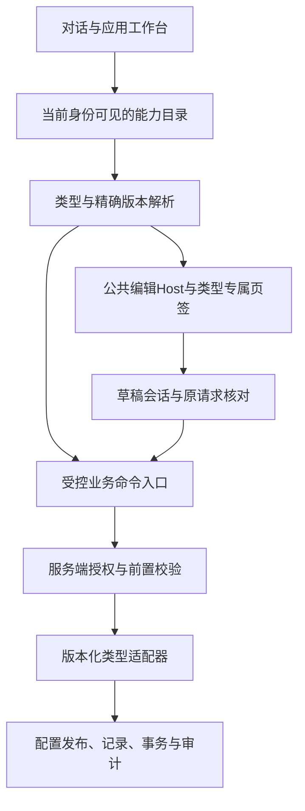

# 应用类型扩展架构：边界、注册与迁移

第三方Agent接入另按[能力中心与接口蓝图](agent-integration.md)执行。用户最新方向先推进其中I0只读能力定义，本文A—E保留为类型扩展内部演进顺序；两条工作线不在同一变更中同时重构业务运行包。

日期：2026-10-23。状态：基于当前源码的后续设计，不代表下述注册协议、统一会话或能力目录已经实现。沿用[类型协议](application-type-extension.md)、[开发与版本规范](development-and-versioning.md)与[统一编辑器约定](unified-application-editor.md)。本次只改文档。

## 当前判断

现阶段适合继续采用模块化单体：一个平台统一身份、应用实例、草稿、发布、命令、审计和事务；类型模块提供业务差异。暂不拆微服务或开放远程插件。既有数据库事务能够保持创建、记录与审批的一致性，新增服务会引入额外的跨服务命令和恢复问题。

已经实现的基础包括后端ExactTypeRegistry、前端精确版本编辑器映射、登记/请假1.1共用Host和字段设计组件，以及不可变发布与原请求核对。注册仍是编译期白名单，不能把配置或AI输出当成可执行模块。

| 源码现状 | 问题与后续边界 |
| --- | --- |
| applicationEditors.ts按类型、版本映射整套编辑器 | 已有精确解析；尚无专属页签与公共Host的完整扩展描述 |
| ApplicationWorkbench.tsx包含类型ID对应的说明与创建提示 | 新类型仍需改公共页面；应改为消费受审查的类型展示描述 |
| UnifiedFormEditor通过workflow是否存在选择流程页与审批记录 | 当前两类有效，不能作为通用能力判定；应由已解析类型能力决定，内容仅供编辑 |
| UnifiedFormEditor保留独立草稿/命令状态，课程也有自身实现 | 视觉复用不等于状态统一；提取会话须先证明不同发布校验及恢复语义兼容 |
| unified_editor/runtime.py包含版本化运行分派及自身摘要 | 属于已冻结1.1实现；不得直接改成通用注册中心而破坏现有摘要 |
| intent/requirements.py中的recipe及各运行入口有内置类型选择 | 类型注册并不自动获得创建/对话/办理能力；需分别提供受控适配和验收 |
| course_type的旧摘要使用implementation_version与Schema | 不能宣称旧课程已经按实际执行源码完整固定；补强须新版本，不重算旧摘要 |

## 目标依赖与职责

目录控制发现和解释，不授予执行权限。每次命令仍重新校验身份、租户、应用、发布/对象范围和当前状态。浏览器隐藏按钮、AI判断和目录缓存都不能替代服务端授权。

| 层 | 平台固定部分 | 类型提供部分 |
| --- | --- | --- |
| 管理外壳 | 应用列表、基础信息、访问范围、页签、状态、确认、错误恢复 | 名称、说明、专属页签、受支持的设计能力 |
| 编辑会话 | 目标绑定、修订、未保存保护、未知结果核对 | 内容读写适配、语义校验、预览与变更摘要 |
| 创建 | 原子创建、来源快照、确认、重复请求恢复 | 默认配置、模板、复制规则、可用生成profile |
| 业务入口 | 统一目标、授权、命令生命周期、审计关联 | 输入输出协议、状态转换及执行器 |
| 存储 | 应用身份、配置发布、命令与业务对象标识 | 业务表与字段语义、迁移和查询适配 |

同一类基础信息保持同一组件。差异通过页签和受控能力增加；不允许类型替换平台身份、发布、权限或任意注入脚本。

## 编译期扩展描述：下一阶段拟定的接口

分为服务端权威运行描述、前端编译期显示描述；二者不是互相信任的动态模块加载器。现有type-manifest严格Schema保持不变，新增描述先使用平台内部对象，确需对外交换时再单独设计版本化Schema。

| 描述部分 | 拟包含的内容 | 约束 |
| --- | --- | --- |
| identity | type_id、精确type_version、配置Schema、编辑协议 | 无latest回退、无重复覆盖；新协议必须显式兼容 |
| presentation | 类型名称、创建说明、运行说明、空状态 | 纯文本元数据；不决定可用性或权限 |
| editor | 使用的Host、公共页签、专属section标识、字段保护 | section标识映射本地组件；禁止任意模块路径/表达式 |
| creation | 模板、默认值、允许复制来源、生成profile | 固定来源版本和摘要，复用原创建确认，不自动发布 |
| capabilities | 能力ID及版本、输入输出、动作种类、角色与前置条件 | 只有实际执行器和验收齐备才可对外发现 |
| runtime | 受审查的校验、发布检查、运行与记录适配 | 服务端编译期注册，不接收客户端类名或代码 |

前端和后端存在独立产物，不能保证天然同步。构建检查应核对受支持的类型/精确版本/编辑协议交集；目录输出时区分已安装、可配置、可发布、可办理。浏览器缺少编辑器应明确不可配置；缺执行器不因有编辑器而宣称可办理。单个坏类型隔离并报可诊断错误，不拖垮整个目录。

不要复用单一installed布尔值表达所有阶段。上述能力状态属于派生目录视图，不直接修改现有实例或发布记录。停用/归档、权限不足、未发布、类型不兼容分别说明。

## 公共会话的状态与命令约束

拆开三种状态，避免一个busy或dirty包含所有含义：

- 读取状态：loading、ready、failed；失败时不把旧对象显示为新对象的成功结果。
- 编辑状态：clean、editing；发布差异独立从已保存草稿与发布基线推导。
- 命令状态：idle、sending、unknown、conflict、rejected；校验结果另绑定当前草稿修订和内容摘要，修改后失效。

每个会话固定tenant/application/type/version；身份令牌变化须重新授权读取。业务对象命令还固定task/object/release等实际目标。待核对命令持有原目标、参数、修订和幂等键，切换应用不能重新绑定；已知409不等于未知网络结果。成功写入后刷新失败应标明“写入已确认、视图待刷新”，不能重新发业务操作。

会话只协调现有命令，不新增第二套服务端草稿或命令表。课程的试跑回归与表单的结构校验是不同发布策略，通过适配接口保留。首次提取只接入一个编辑器，验证离开/保存/冲突/未知结果后再接第二个；冻结的1.0编辑器继续原实现。

## 配置、能力和流程的边界

配置选择已安装能力，不能凭JSON增加执行能力。复用FormFieldDesigner仅代表支持既有单分组、30字段和七种组件的编辑；新的业务类型仍要有独立Schema、保护规则、发布检查及运行验收。

单级审批目前只允许流程/节点名称配置，审批人固定实际发布管理员。多级、条件分支和人员目录属于新的执行协议与类型版本：先定义确定性条件、任务生成、并发、撤回/接管、审计和在途快照，再开放设计界面。配置回滚只恢复配置为新发布，不撤销既有业务事务。

AI分成配置生成和开发代码两条链：前者只产出受能力约束的提案，由服务端校验和人工确认；后者提交受审查的类型模块、迁移和测试，经平台构建发布后才成为可用能力。生成一个清单或流程图不等于安装应用类型。

## 分段实施与开放门槛

| 阶段 | 一次只完成的变化 | 验收与恢复边界 |
| --- | --- | --- |
| A，优先 | 提取前端类型展示描述，消除工作台说明中的类型分支 | 三类创建说明及旧实例入口一致；未知版本拒绝；平台源码回退即可，不动摘要输入 |
| B | 新版Host按显式能力描述装配页签，移除以workflow存在与否推断类型 | 登记无流程页、请假保留核心字段及审批记录；同修订暂存/发布/核对全链路；不改冻结runtime |
| C | 抽取编辑会话，逐个接入新版编辑器 | 读竞态、修订冲突、丢响应、成功后刷新失败、跨应用切换与退出恢复均通过；保留可回退平台产物 |
| D | 新平台注册层组织创建/运行/对话适配，保留旧版本委托 | 同一能力从对话和页面调用获得一致权限/对象/结果；缺失适配不开放；双版本共存及旧快照回放 |
| E | 扩展包交付检查与新类型样板 | 一个新类型仅新增模块、注册声明、独立迁移及测试；不改Host、身份、命令或公共发布机制 |

不将A—E和新审批引擎放在一次修改中。A完成不宣称全系统已经插件化；D也不授权改动已发布运行包。若必须改变冻结实现，先出新类型版本、迁移设计和旧版本执行测试，不通过跳过摘要或改用户数据解决。

每段记录源码基线、受影响旧流程、检查范围、平台/类型/Schema/数据库版本影响和恢复边界。公共UI回归至少覆盖三类配置、未保存切换、发布核对和窄屏/键盘操作；业务变更另加独立Schema数据库测试。DOM、开发服务可用、源码归档均不能替代真实浏览器、生产构建或数据库灾备。

## 新类型交付清单

1. 明确完整用户流程、角色、数据范围及不支持能力。
2. 提供唯一精确版本、Schema、模板及正常/非法配置样例。
3. 注册显示描述和专属页签，复用公共组件，不复制整套工作台。
4. 实现服务端校验、发布门槛、运行、记录和必要迁移；显式绑定不可变版本。
5. 提供受控能力定义，覆盖对话发现、页面操作、错误与原请求恢复。
6. 验证现有课程/登记/请假、租户隔离、新旧共存和真实浏览器；记录可恢复产物和数据恢复条件。

现阶段可支持“增加受审查类型模块，再创建许多配置实例”。尚不能支持上传任意业务JSON就运行、AI即时安装任意代码或任意复杂流程，这些边界必须在管理界面和交付说明中保持清晰。
