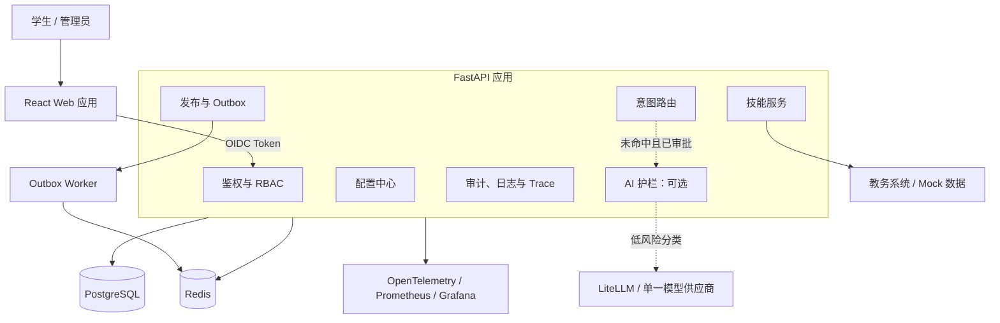

# 校园 AI 一体化平台开发计划

2026-10-23 第三方Agent接入设计：新增[能力中心与接口蓝图](docs/architecture/agent-integration.md)，明确平台数据权威、外部数据来源、用户/客户端授权交集、只读MCP、版本化外部接口、平台可信确认、prepare/execute幂等与原命令核对。当前OIDC校验不等于外部OAuth授权；现有域命令记录不等于统一外部查询。按用户最新方向，下一实现优先I0编译期只读能力定义，再I1受限连接与只读接入；原类型展示A仍为独立待办，不混入编辑会话/流程引擎重构。本轮仅文档，路径和工具为设计草案，未部署MCP、未签发授权、未调用真实Agent/模型、未改代码/Schema/数据库；核对文档链接与修改范围，不冒称联调完成。既有构建、浏览器、Git及灾备缺口保持原记录。

2026-10-23 架构复评与后续顺序：新增[类型扩展架构路线](docs/architecture/type-extension-roadmap.md)，按源码区分精确注册/公共UI已实现与类型展示、能力装配、会话、创建/运行分派仍分散的缺口。确定模块化单体、编译期受审查扩展、服务端能力授权、旧版本不可变和分段A—E验收；下一实现从A前端展示描述开始，不并入新流程引擎或冻结运行包重构。校准类型协议中的早期“只有课程”描述。本轮仅文档，无产品代码、Schema、摘要、数据库或用户数据改变；校验本轮相对源码归档的改动范围、文档链接及空白，不重跑业务测试，不新增已交付能力声明。生产构建、浏览器、Git增量提交和数据库灾备限制保持原记录。

2026-10-23 字段较多时的编辑体验：公共FormFieldDesigner新增字段/必填统计、按当前顺序的快速定位、单项与全部折叠，定位展开并聚焦目标字段；隐藏配置保持挂载，不丢失未暂存内容。仅组件本地显示状态，不写配置、不触发AI，不增加类型协议或数据库变更。旧1.0编辑器及运行摘要输入保留。修改前92019d源码恢复演练通过；quick四组通过（`.local/checks/field-outline-20261023.json`），四套DOM通过，新增折叠保留选项、定位焦点和零写入断言；最终定位滚动调整后专项DOM另行复验。后端未改未重跑，211项是此前证据；真实浏览器、窄屏视觉、生产构建、本地API连接、Git增量提交与数据库灾备仍单列。

2026-10-23 公共字段设计器抽取：新版登记/请假通过FormFieldDesigner复用组件、顺序、选项、约束、必填和响应式宽度，核心字段显示保护说明；Host继续持有配置副本、脏状态、校验、原请求和发布。无API/Schema/类型摘要/数据库变化，旧1.0源码不变。实施前c8c2c4d源码恢复演练通过；quick四组检查通过（`.local/checks/field-designer-20261023.json`），四套DOM通过，新增登记字段切换单选/选项/桌面宽度暂存与请假核心字段保护验证。最终文案后检查见`.local/checks/field-designer-final-20261023.json`；后端未改未重跑，211项沿用上轮证据。真实浏览器、生产构建、本地API连接、Git增量提交与数据库灾备仍单列；源码归档不代表数据库恢复。

2026-10-23 配置页内部布局统一：抽取ApplicationConfigHeading用于课程各页及统一版基础/表单/预览/流程/历史；统一版采用公共application-detail字段样式，底部操作移出页签留白区，发布记录移除额外面板边框。用户流程仍为编辑→暂存→校验→明确发布，原锁、请求号和旧1.0实现不变，无API/Schema/数据库改动。实施前6062d63源码恢复演练通过；quick四组检查通过（`.local/checks/editor-panels-20261023.json`），四套DOM回归另行通过，包含操作栏层级及流程标题检查。本轮未重跑后端（沿用上一轮211项证据），未宣称浏览器或生产构建验收；本地API冒烟上轮连接失败，本轮未重试。Git增量提交和完整数据库恢复仍未完成。

本轮实际验证：`.local/checks/editor-chrome-full-20261023.json` 中10组通过（含隔离后端、四套DOM、类型/契约/Schema/SSR与意图评测），运行接口冒烟因本地API ConnectError失败，总体报告为failed，不宣称全部通过。检查期间源码不变；检查后仅补本验证记录。源码67210312恢复演练通过（231文件）。真实浏览器、生产构建和Git提交仍待完成。

2026-10-23 公共编辑区显示收拢：课程与统一版登记/请假采用共同标题、发布/未保存标签及底部修订/栏目/操作栏，统一按钮样式并支持窄屏换行。新增类型复用约定已补入统一编辑器方案。仅平台展示层，无API、Schema、类型摘要、数据库或用户配置写入；旧1.0.0实现保留。实施前源码d3e33723恢复演练通过（230文件），Git提交/完整数据库恢复仍非本次交付。验证记录目标 `.local/checks/editor-chrome-full-20261023.json`，真实浏览器与生产构建须单独验收，以报告实际状态为准。

2026-10-23 统一发布变更核对：抽取ApplicationChangeReview供课程与统一版共用基础/角色对比，统一表单补字段/顺序/流程名/节点名变更摘要。新增管理员按tenant/application/release精确读取配置快照接口，加载一致的发布基线再进入编辑；角色次序变化不误判权限修改，真实角色变化说明旧记录访问入口影响。无类型适配器/旧摘要、数据库或业务数据改写；DOM验证发布快照隔离、改流程后重新校验、角色对比，隔离HTTP验证快照授权与跨应用拒绝。完整结果见 `.local/checks/publish-review-20261023.json`；真实浏览器/生产构建仍单列。

2026-10-22 统一工作台与单级流程配置增量：新增登记/请假1.1.0运行适配并保留所有旧1.0源码/摘要。新实例及新需求默认统一版，公共基础/访问/导航/暂存发布由同一编辑器复用，按类型开放字段/流程/记录；流程名及审批节点名可暂存、校验和明确发布，旧申请固定原快照。旧实例不升级，提供复制设计引导；历史生成提案按旧摘要继续旧版本创建。共享路由按版本复用原记录/审批/草稿执行器，无迁移和用户业务数据改写。新增隔离集成覆盖新版本HTTP校验/提交、草稿重放、新旧共存、流程改名发布后旧申请照常审批；DOM覆盖共享页签/基础、流程编辑暂存及发布丢失响应同键恢复。完整回归证据 `.local/checks/unified-editor-v11-20261022.json`；真实浏览器、生产构建、原地升级和多级/分支执行仍单列。

2026-10-22 统一编辑器第二段（精确版本解析基础）：后端ExactTypeRegistry按类型/精确版本匹配、拒绝重复注册和提供器身份/摘要错配，现有三个提供器与摘要保留；前端编辑器也按精确版本选择，创建过滤无对应编辑器的版本。新增5项后端专项验证合成双版本共存/无latest回退/防覆盖/元数据隔离/旧类型一致，DOM覆盖未知版本不套用旧编辑器。尚未安装新版本、迁移现有实例或开放流程配置，新版本运行适配和模板创建选择仍是前置待办。完整验证见 `.local/checks/editor-version-registry-20261022.json`；无数据库或用户业务数据改动。

2026-10-22 用户实际验收后的主线调整：优先统一跨类型配置体验与可执行流程设计，暂停继续堆叠零散入口。审计确认课程/登记存在两套公共编辑界面，请假流程为固定单级展示。按[统一编辑器改造方案](docs/architecture/unified-application-editor.md)分段推进：本段已抽取ApplicationSettingsFields/ApplicationConfigTabs并接入课程；登记/请假迁移必须先建立精确版本并存，不能改已发布1.0.0摘要。流程默认先单级受支持字段的设计闭环，多级/分支需执行器配套。当前不宣称三类已统一或流程已可配置；验证结果见 `.local/checks/editor-foundation-20261022.json`，无业务数据/发布写入。

2026-10-22 我的工作已加载列表筛选：按应用名称/应用编号/草稿或记录编号筛选，忽略首尾空格和大小写，显示匹配数量、限定当前页及最近100项范围；区分“无记录”和“无匹配”，保留分页与清除入口，修改筛选关闭旧详情。仅共享前端，不改后端、类型摘要、数据库或业务记录。DOM覆盖编号匹配、空匹配提示、应用编号跨分组匹配、清除恢复及零列表请求；增量证据 `.local/checks/my-work-filter-20261022.json`。真实浏览器与生产构建独立验收。

2026-10-22 我的工作逐条详情：新增共享只读详情视图，待审批/本人提交记录可直接按原应用ID和记录ID查看提交时字段/值/版本，请假附当前状态/天数/处理说明。复用既有逐条授权接口及字段格式化，不改冻结类型运行组件、后端、数据库或业务数据；办理保持原应用确认链路。详情刷新失败清除旧值、切换中止旧读取并验证返回记录ID，支持关闭/重试。DOM覆盖登记历史值/版本、失败恢复、请假状态、迟到响应隔离和零业务写入；增量证据 `.local/checks/my-work-detail-20261022.json`。真实浏览器与生产构建独立验收。

2026-10-22 我的工作刷新与分页恢复：列表快照绑定当前身份令牌/页码/刷新轮次，刷新中或失败时隐藏旧草稿/审批/记录入口，提供明确重试提示；草稿数量减少使页码越界时自动重读有效页。仅共享前端只读列表，不改后端、类型摘要、数据库及业务记录。专项DOM覆盖延迟刷新隐藏三类旧入口、失败无旧目标、重试恢复、第二页数量减少自动回第一页并续填。增量证据 `.local/checks/my-work-refresh-20261022.json`，既有后端203项完整回归沿用；真实浏览器与生产构建独立验收。

2026-10-21 创建确认续期闭环：确认摘要增加“重新生成创建确认”，重读原需求验证修订/动作，以新幂等号准备新摘要，保留名称/模板/原复制或AI来源；AI不重新生成。允许只读打开历史过期摘要，识别过期时禁止执行；服务端409拒绝执行时保留原摘要以便更新，结果未知仍先核对且禁止另开。无后端、类型摘要、数据库或业务数据更改；DOM覆盖过期禁用→更新→新请求号/同AI来源→仍需确认、不自动创建。增量证据 `.local/checks/confirmation-renewal-20261021.json`；既有203项后端回归沿用未变产品后端证据，真实浏览器及生产构建仍单列。

2026-10-21 创建结果与配置衔接：需求创建成功及原请求核对成功后，在列表上方展示结果卡片（原需求/应用编号/继续配置并发布），使用实际返回关联进入配置，不自动发布。未知结果不显示成功，开始新需求或新操作清除旧结果；刷新继续复用需求列表恢复。共享前端增量，不改后端、类型摘要、数据库或业务数据；专项DOM覆盖丢失响应时无成功卡片、核对后真实关联与直接进入配置。增量证据 `.local/checks/creation-handoff-20261021.json`；此前203项后端完整回归见mvp-acceptance报告，本轮不冒称重新运行。真实浏览器/生产构建仍独立验收。

2026-10-21 当前MVP整体验收检查点：对源码0919b3a2f26912ecbce3ef394c61652dbbedabbd27c47d407322b6b4fc4eaa49运行full/live完整回归，11组全部通过，包含203项隔离数据库后端测试、四套DOM、契约/类型/SSR/Schema、意图评测和运行中冒烟，总检查用时约252秒，源码全程未变。前后只读应用配置/发布元数据一致；无真实模型调用，无用户业务验收数据写入。本轮只整理验收记录，未改产品功能。当前进入浏览器集中验收，建议依次测试登记发布办理、请假审批、AI提案调整与历史恢复、跨应用暂停续填、停用后行为；操作见运行手册。完整证据 `.local/checks/mvp-acceptance-20261021.json`。DOM不替代真实浏览器，生产构建和Git提交仍未完成；源码恢复不代表完整数据库灾备。

2026-10-21 AI恢复隔离加固：历史选中请求号按身份/需求/修订写入当前浏览器会话，重复恢复同记录强制重新核对；提案展示前检查返回的需求ID和修订，拒绝无绑定、其他需求及旧修订结果，保留原请求而不重生成。共享前端增量，不改后端、类型摘要、数据库及业务数据。DOM覆盖三类绑定异常、正确结果恢复、无额外模型调用、重复恢复清除旧接受；测试环境补齐浏览器sessionStorage全局。证据 `.local/checks/construction-binding-20261021.json`；真实浏览器及生产构建仍单列。

2026-10-21 AI历史提案恢复：最近操作显示AI生成及明确状态，支持只读查看历史结果/用时，并从已完成且带原需求的记录继续核对。恢复先读取原需求并验证修订和可创建动作，再绑定原请求号进入AI核对；重新接受后才允许创建确认。改动仅共享前端，不改后端、类型摘要、数据库或业务记录，不保留描述/文档原文。DOM验证历史提案恢复到创建确认不自动创建、已转换需求拒绝恢复，既有原请求核对继续回归；证据 `.local/checks/construction-history-20261021.json`。无真实模型调用；真实浏览器与生产构建独立验收。

2026-10-21 最终创建确认可读核对：复制/AI来源的确认页复用共享只读设计视图，显示目标名称、来源修订/AI来源并保留完整JSON。课程提案补充列顺序、显示/隐藏及自定义查询规则摘要，表单/请假沿用字段布局核对。界面不触发创建/发布；专项DOM覆盖实际复制选择→准备确认→目标名称和来源修订核对→明确创建及原请求恢复。未改后端、类型实现摘要或已有业务数据；增量证据 `.local/checks/construction-confirmation-20261021.json`，真实浏览器/生产构建仍独立验收。

2026-10-21 创建入口异常恢复：AI状态区分检查中/已启用/未启用/身份环境受限/检查失败，增加只读重新检查；未启用不允许新生成，但保留已有请求核对。复制来源过滤非可用、停用/归档和其他类型，显示短ID、加载/空/失败状态并支持刷新；刷新清除选择，异步结果按读取序号隔离。复用后端授权与确认，不改类型摘要、业务数据或数据库。专项DOM覆盖失败恢复、空列表、来源筛选、AI停用/403、保留复制选择和停用后原请求核对；检查报告 `.local/checks/construction-recovery-20261021.json`。无真实模型调用，真实浏览器与生产构建仍独立验收。

2026-10-21 AI提案调整闭环：成功提案新增“调整需求重新生成”，取消确认保留原接受状态；确认后清除旧接受状态、保留本页描述/文档并解锁修改，明确点击生成才以新请求号调用模型，新结果需重新接受。界面说明每次使用完整描述/文档，不自动继承上一提案。复用原生成与幂等核对协议，不改后端、类型实现摘要、数据库或已有应用。合成DOM覆盖取消/确认调整、无自动调用、新旧请求隔离和再次接受；增量检查见 `.local/checks/construction-revision-20261021.json`。未调用真实模型，浏览器与生产构建仍需独立验收。

2026-10-21 AI提案核对体验：在共享创建入口增加只读核对视图，展示表单顺序、必填/选填、选项、填写限制、三种屏幕宽度及使用角色；请假明确固定单级审批边界。完整JSON保留，创建草稿与发布仍分别确认；重新核对原请求清除接受勾选。文件读取加入序号保护，过期读取不覆盖当前选择。未修改后端、已发布类型实现/摘要或业务数据；增量类型/契约/接口冒烟与四套合成DOM回归通过，具体证据见 `.local/checks/construction-preview-20261021.json`。真实浏览器验收及生产构建仍单列，不以DOM代替。

2026-10-21 工作台创建入口与状态优化：P1—P6受限MVP已按上一轮203项后端测试、界面自动回归及源码/14表恢复演练完成自动验收；当前是用户浏览器验收与体验完善阶段。工作台新增“AI / 复制 / 文档创建”入口，复用本人建设需求和原确认/发布链路，不自动保存或创建；未保存与待核对操作继续保护。需求按钮改为“选择方式创建”，模板说明按课程/登记/单级请假区分，左侧应用列表显示停用与归档状态。未改类型实现、类型摘要、数据库、既有应用配置或业务记录。最新增量证据见 `.local/checks/workbench-entry-20261021.json`，操作见[测试手册](docs/runbooks/assistant-requirements.md)。Git提交、生产构建和人工浏览器验收仍独立记录，不将开发服务可用当作正式发布。

2026-10-20 P3单级请假增量：实现固定发布管理员来源的请假模板、受保护核心字段、流程图、申请与审批任务/审计事务一致、通过/拒绝/撤回/说明原因接管、重复重放与并发冲突、原版本字段/审批人保持和学生/管理员操作界面。0010仅新增审批状态，原十一表摘要不变；九项后端专项及DOM通过，统一回归待最终报告。未接组织目录、不接受任意人员ID、不自审、不自动发送通知；新类型仍默认关闭，继续P4—P6。另隔离新类型故障，避免一个失效实例拖垮健康应用目录；不将阶段实现冒充全方案完成。

2026-10-20 P2登记增量：新增platform.form受限配置/运行适配器、按类型装配表单设计器、无拖拽组件/顺序/选项/约束/响应式宽度、受控试填、共享暂存/发布/回滚及持久幂等、用户提交/核对/本人记录/历史版本详情和管理员记录。需求“简单登记”复用P1确认和原子创建。0009仅新增登记记录，原十表摘要不变；九项后端专项和合成DOM通过，新增类型入口暂关闭，统一回归及后续阶段仍在推进。不把此记录称为全方案完成；实际状态见运行手册P2增量和.local对应源码证据。

2026-10-20 P1闭环增量：0008新增需求业务目标/应用关联及持久命令，完成详情编辑/修订审计、筛选分页/活动额度、未保存保护、读取竞态处理、原操作核对、精确类型/模板摘要确认、事务内复用应用创建、配置入口恢复、真实发布进度和返回使用。课程创建引导可先选已有应用，不将创建文本发送查询/模型。开发库原九表旧列摘要不变；备份扩展十表且保留0006/0007恢复。操作见 [对话需求与创建](docs/runbooks/assistant-requirements.md)。本轮未调用真实AI、未改用户既有草稿/发布制造验收；表单/审批、复制、AI/文档创建和跨应用任务仍是后续阶段，当前不宣称全部实现。最终检查证据以.local/checks对应源码报告为准，真实浏览器与生产构建仍单列门槛。

2026-10-20 方案复评：按当前0007需求实现补细 [P1后续方案](docs/architecture/closed-loop-delivery-plan.md#41-先修复首段的恢复与管理缺口p1-a)，分P1-A需求详情/编辑、未保存保护、列表一致性、命令核对与容量；P1-B已安装类型确认创建和原子转换；P1-C配置发布、恢复并返回使用。明确需求/能力/任务/命令四类状态、历史动作绑定、权限变化和结果未知的恢复。后续优先P1-A，不同时新增表单/审批。仅更新方案与当前版本说明，没有实施这些新接口、迁移或功能，也未重新运行产品测试。

2026-10-20 P1第一段：核对发现Git基线0cf920f已存在，工作区原先干净；据此推进建设需求闭环。新增管理员对话需求引导、本人需求面板、真实保存/重载/取消、同请求号并发幂等及权限/审计；未安装请假等类型不伪造可运行应用。0007仅新增需求表，开发库原八表行摘要迁移前后一致；备份扩展九表并兼容旧0006八表恢复。课程类型/历史发布摘要不变，无真实模型调用，不写实际验收需求。已有类型任务转换与回原任务后续衔接，P1尚未整体完成。操作见 [对话建设需求](docs/runbooks/assistant-requirements.md)；生产构建及真实浏览器门槛仍单独保留。

2026-10-20 P0实施：增加源码归档/完整性校验/隔离恢复、八张应用表一致性加密备份/迁移重放/隔离Schema逐行恢复、统一检查入口、开发版本声明和源码/类型/发布关系清单。实际开发数据隔离恢复通过，未覆盖原Schema或改用户草稿/发布。Git已初始化，但config/index.lock写入被环境拒绝，无基线提交；P0仍未全部关闭，不进入新业务开发。生产构建、真实浏览器、异机/异地恢复和完整数据库灾备分别保留缺口。操作与范围见 [基线恢复手册](docs/runbooks/baseline-recovery.md)，具体测试和源码关联以.local报告为准。

2026-10-20 后续开发顺序与治理基线：用户确认以完整操作闭环、良好体验及兼容性优先。新增 [分阶段交付计划](docs/architecture/closed-loop-delivery-plan.md) 和 [开发/交互/版本规范](docs/architecture/development-and-versioning.md)，并以根目录AGENTS.md作为后续AI开发入口。顺序调整为P0源码/恢复/兼容基线 → P1任务草稿与创建引导 → P2简单登记真实数据闭环 → P3单级请假审批闭环 → P4模板/复制/AI文字统一创建 → P5文档导入 → P6跨应用任务和维护；优先级高于下方历史阶段安排。未安装业务类型仅保存建设需求，不伪造可运行应用。评估确认当前目录不是Git仓库，类型摘要尚未覆盖实际实现字节；这两项列入P0/类型升级前置。正式发布需要对应构建与浏览器证据，开发服务通过不能替代。此次仅文档及AI项目约定，无源码功能、数据库、Git初始化/提交、用户配置或模型调用；Git基线、构建环境及恢复演练仍待实施。

本轮最终验证（2026-10-20，对话使用引导）：150项后端测试全部通过，包含openGauss隔离Schema集成；前端类型、SSR/HTTP、DOM操作及契约检查通过。仅更新代码与文档，不修改用户应用、草稿或发布，不调用真实模型。请继续使用5173开发服务验收，已有生产构建环境限制未改变。

2026-10-20 对话使用引导增量：应用锁定后新增服务端声明的功能按钮，查询今天/本周/查看功能及管理员基础/展示/问法/发布记录导航；历史按钮显式绑定原实例，不受当前会话切换影响。新增授权目录内名称/别名/描述/分类关键词搜索，搜索只筛选待确认候选，管理类关键词不改变搜索权限；补齐空目录/零匹配提示。当前应用名采用匹配结果优先，客户端同步锁拦截同事件周期重复提交，防止重复路由/模型工作。新增4项后端用例，15项路由测试通过，类型、SSR/HTTP、扩展DOM操作和契约通过；运行中搜索/7项管理员功能/查询及问法导航作用域检查通过，5173加载当前模块。无迁移、用户应用/草稿/发布写入和真实模型调用；完整回归结果见下方实施记录及运行手册。

2026-10-20 对话分层路由与重复列表修复：定位原因为Workspace初始固定schedule且发送直接走实例查询，ConfigAdmin嵌入状态仍挂载旧aside。新增仅已授权目录驱动的assistant/resolve，先应用发现/名称锁定/候选澄清，再分发功能；支持显式切换、相对日期追问、功能说明，以及管理员按应用定位基础/页面/问法/历史入口；不自动执行配置写入、删除或发布。校园助手/新对话回到自动匹配，日期查询需先锁定；历史每条消息保留实际应用身份。未知引用不沿用旧应用，同名实例/嵌套名称/通用问句与应用同名均保守处理；实例及模型调用仍由业务接口独立授权。嵌入面板不再渲染旧应用列表，同名真实实例显示短ID，不删数据。146项后端回归通过，后续边界补充11项路由测试复验；类型、SSR/HTTP、扩展DOM操作及契约检查通过。运行中目录UUID唯一、无同名实例，两个可用应用发现/另一个应用名称锁定/追问路由通过，5173返回当前新模块，原23项查询闭环通过。无迁移、无用户草稿/发布或应用数据更改，无真实模型调用；没有重试已知受EPERM限制的完整构建，旧dist不代表当前开发页面。操作见运行手册最新章节。

2026-10-20 可见多应用闭环：新增真实应用列表与蓝色“新建应用”入口、标准/简洁课程查询模板、创建后自动选中配置、按类型注册编辑器、切换未保存保护、写入期间锁定切换及创建持久幂等重试。复用配置面板完成独立基础信息/展示/问法/规则/发布/回滚/审计，新实例暂不显示仅绑定旧schedule协议的AI页面设计；AI问法生成已按应用隔离。微服务广场、已开通列表及工作台“使用应用”可进入指定实例对话，文本/日期查询均使用该实例发布版本，未发布不列出/不可使用，角色受限不列出并拒绝请求。新增0006_application_runtime为新发布固定应用、类型版本/摘要和课程能力契约，旧历史内容不重写；开发库迁移前后五张表旧字段记录数/摘要一致。135项后端测试全部通过，含新建模板→问法审核→试跑发布→目录→真实HTTP查询/权限闭环及模拟AI生成隔离；类型、SSR/HTTP、24条Schema、契约及扩展React DOM操作回归通过，覆盖创建响应丢失、创建成功后列表拒绝的同键重试、切换丢弃/取消、独立暂存、发布和指定应用查询。运行中原23项闭环通过，5173新模块与API代理200。无真实模型调用、未写用户验收应用或修改原草稿/发布。完整构建及native配置加载都仍报spawn EPERM，旧dist未更新；用户应在http://127.0.0.1:5173/#workbench验收，真实浏览器视觉/移动端未由自动化验证。当前只有课程类型且共用当前教务能力，表单/审批、对话自动发现、生命周期、类型升级及新实例AI页面提案后续实施。操作见docs/runbooks/application-management.md最新章节。

2026-10-20 多应用后端基础层：实现编译期课程类型注册/类型摘要、应用身份表、管理员类型与应用列表、持久幂等创建、封装草稿读写；配置状态/发布/审计/Outbox/问法库及缓存加入应用作用域，旧课表固定兼容UUID并保持原接口、状态和幂等历史。新增0005_applications，实库隔离Schema验证后已升级开发库，五张既有表原字段记录数/摘要完全一致；修正openGauss空串等于NULL的兼容边界。132项后端测试全部通过（含并发创建、HTTP读写、跨应用发布/回滚/问法/审计/投递及跨租户隔离），发布包契约必需项变更后6项产物测试另行通过；类型、Web SSR/HTTP、24条Schema用例及契约检查通过，运行中ready/类型/应用列表200、原23项查询闭环通过。未调用真实模型、未写用户测试应用或改草稿/发布。当前仅后端基础层，前端新建/切换、新实例发布运行、生命周期、版本升级和新实例AI设计待做；下一步接动态工作台并完成新实例发布快照的类型/能力绑定和运行路由，之后再开放用户完整创建使用。

2026-10-20 类型扩展契约落实：新增 packages/contracts/application-types/v1 四份 Draft 2020-12 Schema、课程类型/实例示例、24 条结构用例及 scripts/check_application_types.mjs，Ajv 8 严格校验全部通过。明确通用封装不能单独作为发布依据，必须选择已安装类型专属 Schema；租户归属、权限、绑定、编辑器注册、摘要及配置冲突仍属待实现语义校验。记录模板创建及对话发现/管理引导方向，暂不开发。未改业务接口、数据库、现有草稿或发布，未调用模型；下一步开发类型注册与隔离存储。

2026-10-20 多应用架构设计：新增 [应用类型扩展协议与多应用配置隔离](docs/architecture/application-type-extension.md)，确定类型族/类型/实例/发布的区别、编译期类型注册、动态配置页、实例封装、租户+应用全链路隔离、权限/生命周期/版本策略、接口草案及课表兼容迁移。下一阶段按“契约冻结 → 课程类型注册 → 数据库隔离 → 旧接口兼容 → 验收后开放创建 → 表单第二类型”推进。现有单课表运行不变，本轮仅文档设计，尚未新增类型 Schema、接口、迁移或业务能力；不表示通用应用已可创建。

2026-10-20 工作台入口排查：5173开发服务实际返回新版main/ConfigAdmin/CSS，旧dist产物不含application-workbench。新增管理员侧栏直达入口及/#workbench启动定位，学生不因链接获得管理界面；React DOM验证直达页确实挂载新版左右布局并默认基础信息，类型和SSR/HTTP通过。实际用户访问地址尚未提供，未将旧包或缓存认定为已确认根因；生产打包更新仍需完成原环境构建。

2026-10-20 工作台管理界面重组：左侧已注册应用列表（当前仅课表）、自动选择/加载第一项，右侧默认基础信息，顶部五项切换：基础信息、页面配置、问法与规则、AI设计、发布记录。问法表格增加来源筛选/分页，新增/修改/审核收纳至侧边抽屉；规则折叠，运行诊断收纳历史区。沿用登录会话并移除重复令牌输入，底部统一暂存和试跑发布，发布面板集中试跑/变更/回归/确认，保留同命令幂等重试。切换功能保留组件状态；AI需求/提案、问法编辑和未知写入结果纳入离开保护，阻止相互覆盖，自动加载具有超时与取消。前端类型、SSR/HTTP、模拟React DOM状态回归及契约检查通过，运行中23项原查询闭环通过。完整构建依旧在当前执行环境报spawn EPERM；浏览器视觉/移动端尚需验收。不改后端、迁移、业务草稿或发布内容，不调用真实模型。操作见docs/runbooks/application-management.md最新布局说明。

2026-10-20 问法学习库首版：按用户确认实现应用工作台问法管理、手工增改/拒绝/停用/软删除、AI每批1～20条候选生成、成功AI兜底查询候选采集及重复频次/解释分布统计。待审核不参与查询，审核在配置行锁下完成冲突与回归检查并写入规则草稿及审计；发布后才匹配，停用/删除需再发布，回滚遵循真实发布快照。现阶段编译为五种相对日期exact规则，不存课程答案、不自动启用，来源与状态独立显示，支持筛选及频次排序。新增0004_question_library并已在开发库升级，迁移前后草稿/发布摘要一致。123项后端测试含隔离openGauss集成全通过，覆盖并发采集合并、原子审计、租户/修订边界、修改去重、解释冲突、停用/回滚及HTTP完整链路；HTTP验证发布后同问句不再调用AI。类型/SSR/HTTP/契约、227合成问句及运行中23项原闭环通过，运行中问法列表及新增前端模块返回200。模型均使用模拟响应，无真实付费调用；用户问法库未写入演示数据，未改用户草稿或发布。新增界面及真实模型批量生成待用户浏览器验收，生产构建的既有spawn EPERM限制未解决。每组织最多500条记录含删除，每问法占一条规则，总草稿规则仍限50；具体星期/日期参数模板、批量审核、独立用户计数和向量检索待后续。

2026-10-20 查询兜底增量：用户确认此前浏览器完整操作验收通过。本轮新增查询总用时/AI用时提示，未调用AI显示0；完整规则命中直接查询，未命中且无否定、多日期、星期歧义或规则冲突才尝试AI，输出置信度至少0.9、再次通过规则解析并保留原明确日期才执行。模型只解释问句，不生成课程记录；超时/异常保留澄清，当前只使用本地演示租户的已启用模型。新增query_llm_*指标，学生llm_calls不再固定为0。109项后端测试含隔离数据库集成通过，随后新增HTTP耗时字段回归单独验证；类型/SSR/HTTP/契约及227合成规则通过。本轮新增UI仍待浏览器复核。首次回归意外命中本机真实模型，已修正统一测试入口默认隔离查询模型，后续测试使用模拟响应。不修改用户业务草稿或发布内容。

> 版本：v1.4  
> 状态：MVP 开发版待统一验收；真实校园接入及业务验收未完成  
> 更新日期：2026-10-18
>
> 实施记录更新：2026-10-19

### 当前实施结论（优先于下方历史记录）

2026-10-19 M1 模型接入：应用管理新增 AI 模型配置，工作台支持自然语言生成课表提案；按用户提供的 DeepSeek 地址及 deepseek-chat 保存并启用测试配置。API Key 在本机 *.secret 文件中以 Fernet 加密保存，不回显、不入文档/发布包；配置/调用限定本地 demo 管理员。支持启用、基础地址、模型名、密钥替换/清除、超时、输出token参数/JSON模式及单进程小时次数限制；换地址不复用旧密钥，配置并发按revision拒绝。生成只发送设计元数据，不调用工具、不改草稿，严格校验JSON/绑定/草稿版本及原课表回归；成功审计只记模型/版本/用量/提案摘要，学生模型调用仍零。真实连接与运行中生成均通过，生成两项可接受操作且用户草稿未变。100项后端含数据库集成全部通过，类型/SSR/HTTP/契约、227合成规则和运行中23项原闭环通过。无新增迁移；模型非流式、无自动修正/服务端取消，进程次数限制不等于持久金额预算，浏览器交互及本轮生产构建待验收。操作见 docs/runbooks/ai-model-configuration.md。

2026-10-19 M1 首步实现：应用工作台新增人工课表 JSON 提案面板，后端提供 context/preview/accept。支持现有列、顺序、合法规则和元数据，严格限制身份/角色修改、重复键、类型、128 KiB 请求预算、修订/内容/目录摘要和回归护栏。预览不写库，接受在 config_state 行锁下只保存草稿，并以现有 config_audit 的确定命令标识及请求摘要实现租户/操作者隔离的持久幂等；无新增数据库迁移。页面接受结果不确定时保留原请求号并阻止新写入，成功后重载当前草稿，不用旧重放结果覆盖后续编辑。90 项后端测试含 openGauss 隔离集成全部通过，无跳过；类型/提案 SSR/HTTP/契约、227 条合成问句及运行中23项原闭环通过；运行中新增 context/preview 返回200。未接受或发布用户实际草稿；浏览器交互及本轮生产构建未验收。AI 模型、自然语言生成、预算和取消仍未实现，下一步先验收人工提案链路，再接单一模型设计适配。

2026-10-19 按最初目标优化蓝图：优先证明管理员配置自助及规则优先低成本解决课表请求，保留后续 AI 表单/流程/视图方向。新增 `docs/architecture/mvp-design-alignment.md` 对应原第 1/2/5/6/9/11 章，调整顺序为 M0 课表复验 → M1 课表配置设计助手 → M2 UAT/成本/解决率验证，再按需进入通用阶段。补充 course-context/course-proposal 专用 Schema 及示例，直接约束现有 DisplayConfig 的列、顺序、规则和元数据，不允许模型改角色、身份、技能或服务地址，不强制先迁移课表到通用模型。管理端设计 AI 与学生运行 AI 独立开关、预算、指标；先复用现有配置发布/审计/Outbox，不预建第二套发布中心。5 份 Schema、8 份示例及 38 条结构期望通过 Ajv 2020-12 验证；专用 Schema 与现有配置 Schema 快照一致，示例应用后的 DisplayConfig 和现有发布回归通过。语义用例仍为后续验证器标准，AI 助手和运行时尚未开发；本轮无业务代码、数据库或已发布内容变更。原 3 名管理员 UAT、100 条真实问法、P95/成本/权限等门槛保持，缺证据不标记已验收。

2026-10-19 AI 设计蓝图：按用户要求先冻结讨论用契约、再开发功能。新增 `packages/contracts/application-design/v1` 下应用包、AI 上下文、AI 提案三份 Draft 2020-12 JSON Schema；新增标准说明、六份关联请假示例、26 条结构/语义验收向量，以及 `docs/architecture` 下开发蓝图与 AI 生成规范。覆盖无拖拽表单/布局、有限流程、数据视图、权限、能力目录、最小修改提案、冲突/幂等、澄清、模拟与版本边界。Ajv 8 的 2020-12 校验器验证三份 Schema、六份示例和 26 条结构期望通过，示例摘要/引用/流程路径核对通过；语义用例是后续校验器的验收目标，不宣称已实现业务验证器。示例能力全部 planned，不能发布运行。本轮不改现有业务代码、数据库或已发布配置，不接模型，不开发远程部署；下一步开发按蓝图 A 阶段从严格解析、语义验证和表单运行时开始。

2026-10-19 用户调整优先级：Docker 离线部署方案已记录于 `docs/runbooks/application-management.md` 的“后续方案”章节，暂缓实施，保留现有只读检查与审阅能力。当前主线回到课表 MVP：学生登录/查询/错误恢复、管理员暂存/试跑/发布/回滚、身份与租户边界及验收闭环；不继续开发远程安装或更新执行器。真实校园认证、教务接口和 UAT 仍依赖外部资料，不能以合成评测替代。旧记录中的“下一步部署执行器”不再是当前实施顺序。

2026-10-19 服务器检查增量：生成部署计划时复用同一已核验指纹的 SSH 连接，增加固定 Python 只读探针，读取目录类型/所有者/权限、current 指向、磁盘、Python 3.11+/venv/ensurepip、监听端口及三个固定 systemd 服务状态。探针不读取 TOML 内容、不写文件、不执行 sudo；只接收校验后的版本号。计划摘要绑定检查快照，页面展示空间门槛、阻止项和未验证条件；完整构建未验证、依赖缺失、危险目录、已有版本、配置权限不符、空间不足、端口冲突或状态未知等不会被视为可执行。修复 SSH 持续输出绕过超时的边界。78 项后端测试（含 openGauss 隔离集成，无跳过）及类型/契约/SSR 通过；探针使用假文件系统和假 SSH 测试，没有真实 SSH 联调。sudo、服务配置/端口归属、生产配置、备份、健康检查仍需验证；执行前确认与安装/更新执行器仍未实现，execution_available 保持 false。

2026-10-19 发布产物增量：新增 `scripts/package_release.py`，默认完整构建后按白名单生成确定性 tar.gz，清单记录版本、前端构建状态及逐文件摘要；本地配置、缓存、测试和源码映射不入包。新增归档校验，限制大小/文件数/展开流，拒绝路径穿越、链接、重复条目及清单不符；不解包。生成部署计划现在必须先找到并验证本地内容寻址包，版本不符或文件缺失/损坏在 SSH 前拒绝，页面展示产物信息。70 项后端测试（含 openGauss 隔离集成，无跳过）、类型/契约/SSR 通过；使用已有 dist 生成的审阅包已实际校验，显式标记 prebuilt-unverified、deployment_ready=false。默认完整构建仍报 spawn EPERM，未生成已验证构建的发布包；未连接真实 SSH。下一步仍是执行前远程目录/服务检查、绑定最终计划的确认、上传与安装/更新执行器，本轮不宣称真实部署完成。

2026-10-19 后续增量：服务器部署新增安装/更新审阅计划接口和页面。生成计划时复用独立授权、目标白名单、指纹校验及固定 SSH 只读检查，拒绝未验证指纹、非支持系统或缺 systemd 的目标；计划绑定主机、版本、产物摘要，固定 `/opt/campus-ai/releases/<版本号>`，标明提权、备份及代码恢复要求。表单变化清除旧计划。摘要仅供比较，不是执行授权；未检查实际产物、目录、sudo、磁盘与服务状态，未实现执行前确认或安装/更新执行器。64 项后端测试（含 openGauss 隔离集成，无跳过）、类型、契约及含部署入口的 SSR 冒烟通过。没有连接真实 SSH 服务器，没有执行远程安装、迁移或更新；生产构建与浏览器交互的既有验证缺口仍保留。

### 已确认增量范围：应用管理与本地部署助手

用户已确认：微服务广场增加仅管理员可见的“应用管理”分类，提供“应用工作台”和“服务器部署”。设计可暂存到数据库，不影响已发布版本；发布即生效，不另设发布后部署配置的步骤。先复用课表规则、展示、版本、回滚、审计，增加应用基本信息/可见角色等配置，不实现通用拖拽平台。

服务器部署是独立运维能力：本地后端通过 SSH 用户名/密码连接 Linux，先核对主机指纹、只读检查、展示计划，再经操作者确认进行安装或代码更新。仅本地显式启用并单独授权；密码不入配置/日志/记录，不执行任意输入命令。首个模板限定 Ubuntu 22.04/24.04 + systemd + Nginx；安装依赖需明确提权，代码采用版本目录和健康检查，数据库不承诺自动逆向回滚。

按阶段实施：① 应用管理与暂存/发布；② SSH 指纹核对与只读检查；③ 环境安装/项目更新及恢复。每阶段记录实际验证，缺服务器参数、指纹和操作者确认时绝不连接/修改线上。未完成阶段不能标记已交付；本次开始实现前两阶段，真实安装/更新保持后续工作。

本轮实际进度：应用管理分类/两个入口、课表应用基本信息及可见角色、数据库暂存、发布即生效、目录读取发布快照、后端访问控制和未暂存离开提示已实施，原侧栏入口合并。应用信息扩展现有 JSON 配置包，旧版本补默认值，不改历史、不新增迁移。SSH 只读检查代码与界面已实现：默认关闭、本地来源与独立授权、IP 白名单、先指纹后认证、固定只读命令、密码不落库、输出/并发/超时限制；未安装可选依赖、未真实 SSH 联调、更未远程安装或更新。第三阶段仍为待办，具体验收与限制见 `docs/runbooks/application-management.md`。

本轮验证：61 项后端测试全部通过、无跳过，新增应用暂存重开/发布/回滚实库测试，目录与角色校验、SSH 假传输边界测试；23 项运行中课表闭环通过。前端类型、SSR 管理分类/角色、契约及 227 条合成问句通过。SSH 测试没有连接真实服务器，不能算真实部署验收；浏览器交互与完整构建的既有验证缺口仍在。

2026-10-19 下一步主线：运行中的本机 API 已通过 `verify_mvp.py` 的 23 项演示闭环检查，前次连接问题已解除。继续补齐确定性课表语言规则（v1.2），支持“本周五”“下周三”“下星期一”“下礼拜日”和“今日/明日/后日”。以校园时区、周一至周日为基准，本周过去日期不自动顺延；未说明哪一周的“周五/星期一”、多日期、否定或混合操作仍澄清，不允许管理员别名绕过这些限制。已将新增表达纳入发布前回归，未加入其他业务、AI 或迁移。合成评测从 v1 升为 v2：原“下周三”由不支持转为支持，新增同义问法和安全反例，共 227 条，不能与此前 146 条冻结集混称为同一版本或真实校园数据。

2026-10-19 界面入口更新：以 `界面参考图` 的桌面侧栏、中央对话工作区和移动端导航/应用列表为参考，新增独立登录页、校园工作台和微服务广场。学校界面统一将业务智能体称为“微服务”，这是应用组织方式，不意味着本期拆分成独立部署服务。仅课表助手可用；请假、采购、访问、场地预约、活动管理均明确标注待接入，不扩展本期业务实现。

登录闭环：模拟学生或本地管理令牌 → 服务端 `/me` 验证 → 按角色显示工作台 → 课表对话/管理员配置 → 退出回到登录页。令牌不落本地存储；演示学生退出时撤销服务端会话；401、定期检查及重新聚焦时检测到会话失效会返回登录页。校园令牌退出仅清除本页登录态，不等于校园 IdP 全局退出。刷新需重新登录；查询历史仅本次页面保留最近 30 条，不落库。移动端使用抽屉导航，微服务列表支持分类/搜索。主线安全补齐后已移除无令牌默认模拟身份，身份、发布配置读取和两类课表查询在服务端均要求有效令牌；匿名、过期、已退出返回 401，不读取配置及课表。健康/就绪检查和模拟登录入口仍按用途开放；正式部署必须使用 OIDC，演示模式不可公开。

本次验证：43 项后端测试（含 openGauss 隔离集成）全部通过；TypeScript 通过；新增 `node scripts/check_web.mjs` 服务端渲染冒烟，覆盖登录、工作台、角色导航、HTML 转义和令牌不写入 HTML。完整前端构建仍受 `spawn EPERM` 环境限制，未完成浏览器视觉及交互验收。

后续主线更新：服务端登录门禁补齐后，47 项后端测试全部通过（无跳过），146 条合成问句全通过，类型/契约/SSR 冒烟通过。新增 `scripts/verify_mvp.py`，串行检查模拟登录、学生隔离、自然语言/日期一致性、不支持操作不执行、越权参数及退出撤销；业务数据和配置只读，演示会话结束后清理。已使用当前开发库和最新代码的进程内 HTTP 客户端验证闭环，不据此宣称旧运行进程、真实教务或校园 SSO 已验收。性能工具同步要求令牌，隐藏输入或环境变量提供，不放命令参数或报告，不跟随重定向。本轮不扩展应用范围、不新增数据库迁移、不继续界面优化。

| 能力 | 实施与验证状态 |
| --- | --- |
| 学生自然语言与日期查询 | 共用技能与发布快照；模拟课表完成，真实接口待提供 |
| 模拟业务数据入库 | 2026-10-19 已新增 biz_student / biz_course_schedule，统一业务前缀和表注释；3 名学生、545 条模拟课程，当前配置切换数据库读取。增量迁移 0003_biz_schedule，不覆盖系统核心表或原数据 |
| 管理员规则与展示配置 | 原子发布；精确/关键词、优先级、冲突澄清、草稿预览、差异与回归检查、历史回滚及前后审计完成 |
| 配置持久化 | openGauss 开发库已执行至 0003_biz_schedule；新字段/表为增量迁移，未重置原配置和历史 |
| 缓存与 Outbox | 可选 Redis、数据库回源、不可变版本缓存、租约/退避/重试上限/人工重投完成；真实 Redis 尚未联调 |
| 身份与授权 | 可信上下文、角色与租户隔离、关联账号检查、OIDC RS256 验证接口完成；校园 issuer/JWKS/audience 和账号未提供，前端目前为令牌入口，无自动 SSO 跳转 |
| 模拟身份验收闭环 | 2026-10-19 新增数据库模拟学生选择、只读学生会话及服务端退出失效；只开放本地演示租户的预置模拟学生，禁止选择管理员/覆盖角色或租户。会话一小时、仅进程内保存，重启失效；OIDC 模式关闭所有模拟登录入口，不作为真实 SSO 交付 |
| 教务适配与故障降级 | Mock 与约定的 HTTPS 适配接口、身份核对、超时/并发上限/熔断及无课区分完成；真实教务接口映射和校历未提供 |
| 可观测性与契约 | Trace/Server-Timing/无敏感请求日志/Prometheus 指标和监控入口完成；OTel/Prometheus/Grafana 示例准备，未部署采集栈；Schema/OpenAPI/前端 DTO 自动生成 |
| 验证 | 2026-10-19 应用管理补齐后复验：61 项全部通过，无跳过，含应用暂存/发布/回滚实库、目录/权限、SSH 假传输边界及原课表/配置集成；运行中 23 项闭环、类型、契约、SSR 和 227 条 v2 合成问句通过。SSH 真实联调、浏览器交互及完整构建仍未完成 |
| AI | 条件触发的可选项，未启用；无供应商审批时不调用模型，不能声称 AI 分类已实现 |
| 业务验收 | 未满足：至少 100 条独立真实脱敏问法、3 名管理员 UAT、试点负载及真实系统安全验证。合成数据不能替代 |

统一检查入口为 `docs/runbooks/mvp-acceptance.md`，启动命令为 `python scripts/start_api.py`（使用项目虚拟环境）。当前采用 config_state 合并配置入口/草稿、config_release 内嵌不可变内容、代码及 JSON Schema 模板，满足单一课表场景的版本语义，暂不额外拆出模板平台。后续业务边界仍按第 11 章，未加入本期交付。

性能冒烟记录：Windows/Python 3.11/远程 openGauss，3 并发 30 次，预热 3 次后 P95 125.1ms、零错误；冷连接那轮 P95 619.8ms。此结果不替代原验收要求的固定硬件、真实数据和试点峰值三倍负载。当前 Python 3.11 临时环境、完整生产构建与浏览器自动化仍待环境条件恢复后复验。

以下为历史进度，后续开发以当前结论和原业务验收标准共同约束，不据开发版完成度提前宣告上线。

第三步实现（2026-10-18）：用户已验收展示配置发布/回滚/持久化。新增代码维护的确定性课表意图与日期规则、自然语言查询接口和页面入口，与日期查询复用技能及展示配置；支持相对日、自然周和完整日期，歧义及混合指令不执行，明确“查课表”默认今天。17 项测试通过、数据库集成测试 1 项跳过，前端类型检查通过；构建受环境权限限制，页面待用户验收。本步不增加 AI、会话服务或数据库迁移；规则尚未接入配置发布，不视为第 4 周全部验收完成。

实施进度（2026-10-16）：已建立 React + TypeScript + FastAPI 本地骨架、日期范围 Mock 课表接口、健康检查及请求编号，接口测试 3 项通过。启动与学习步骤见 `README.md`。当前只完成开发探针，不代表第 1 周验收：尚无数据库、真实认证、配置发布或自然语言路由；前端依赖安装被网络阻塞，未完成构建与浏览器验证。Python 3.12 环境初始化受限，暂用本机 Python 3.11 复用已有依赖验证，后续恢复独立 3.12 环境。

第二步实现：用户已验证原 Mock 页面。新增 PostgreSQL 配置草稿、修订冲突检测、不可变发布/回滚、事务审计、本地令牌保护的管理页面，以及查询固定发布版本的实现；提供 Alembic 初始迁移与可选 Compose。7 项非数据库测试通过，TypeScript 检查通过；数据库依赖安装和 PostgreSQL 联调受环境限制，数据库集成测试未执行，完整前端构建受 `spawn EPERM` 限制。具体步骤见 README“第二步”；暂不启用 Redis/Outbox、规则打包或真实认证，不标记完整阶段验收通过。

## 1. 项目目标与范围

本项目首先验证两个核心价值：

1. 管理员能否无需研发介入完成受控的配置变更。
2. 系统能否通过“规则优先、AI 兜底”低成本解决学生高频请求。

### 1.1 MVP 业务闭环

首期只交付“学生查询课表”这一条完整链路：

```text
学生输入自然语言 → 规则路由 → 课表技能 → 结构化结果 → Web 页面渲染
                                  ↑
管理员配置课程展示、匹配规则并发布/回滚
```

### 1.2 本期范围

**包含：**

- 学生 Web 端自然语言查询课表。
- 管理员配置课程展示字段和意图匹配规则。
- 配置草稿、校验、发布、回滚、审计。
- 规则优先的意图路由与课表查询技能。
- 身份鉴权、授权校验、基础监控与故障降级。

**延后：**

- 技能市场、通用工作流、RAG、模型微调。
- 微前端、小程序、多端组件共享。
- gRPC、服务发现、Redis Cluster、etcd、本地二级缓存。
- Kubernetes、GitOps、多模型智能调度和完整灰度发布平台。

请假、采购申请、访问申请、场地预约、活动发布管理用于检查后续扩展边界，见第 11 章；不纳入本期交付和八周验收，不提前创建对应业务表、通用流程引擎或页面设计器。

### 1.3 第 8 周成功标准

| 维度 | 通过标准 | 测量方式 |
| --- | --- | --- |
| 配置自助 | 3 名目标管理员中至少 2 名独立完成配置和发布 | 观察式 UAT，无研发协助 |
| 业务有效 | 至少 100 条冻结真实问法中，课表请求解决率 ≥ 80% | 自动化评测 + 人工抽检 |
| 成本可控 | 高频规则命中请求不调用 LLM；AI 兜底成本可追踪 | 网关计量报表 |
| 性能 | 受控 Mock/本地数据的非 AI 查询 P95 < 300ms；真实教务查询目标基线测量后确认 | 固定负载压测，分别报告平台与上游耗时 |
| 安全 | 越权访问、敏感字段外发均被测试拦截 | 安全测试用例 |

若“配置自助”或“低成本解决高频请求”任一目标不达标，暂停平台化扩张并复盘。

---

## 2. 系统架构



### 2.1 架构原则

- PostgreSQL 是配置、版本和审计的唯一真源；Redis 只做可丢失缓存。
- MVP 采用模块化单体，按业务边界拆分模块，不提前拆分为微服务。
- 学生运行链路的 AI 只能作为规则未命中的低风险分类兜底，随时可以关闭；后续确认的管理端 AI 设计是独立的草稿辅助能力，使用独立开关、预算和审计，不参与规则命中请求，不直接发布或执行业务。
- 所有读写请求携带 `trace_id`；配置发布、技能调用和模型调用均可审计。
- 前端只渲染白名单组件，服务端不得下发可执行脚本。
- 身份、租户和数据范围来自服务端可信认证上下文，与用户输入的业务参数分开；AI、配置和客户端均不能扩大授权。
- 配置发布与业务办理分开建模；回滚配置不等于撤销已提交申请、释放预约或恢复业务数据。

---

## 3. 推荐技术栈

| 层级 | 推荐选择 | 选型理由 |
| --- | --- | --- |
| 前端 | React + TypeScript + Vite | 生态成熟，适合管理端和交互式查询页面 |
| UI 与表单 | Ant Design + React Hook Form + AJV | 组件和 Schema 校验能力完整 |
| 后端 | Python 3.12 + FastAPI | 开发效率高，便于后续接入 AI 能力 |
| ORM 与迁移 | SQLAlchemy + Alembic | 类型化数据访问与可版本化迁移 |
| 数据库 | PostgreSQL 16 | 支持事务、JSONB、索引和审计查询 |
| 缓存 | Redis | 缓存已发布配置及辅助限流；关键写入幂等记录持久化于 PostgreSQL |
| 认证 | 校园统一身份认证 / OIDC | 避免自建密码和账户体系 |
| API 契约 | OpenAPI + JSON Schema | 前后端接口、配置和 UI Hint 可统一校验 |
| 可观测性 | OpenTelemetry + Prometheus + Grafana | 覆盖指标、日志与链路追踪 |
| 测试 | Pytest、Playwright、k6 | 分别覆盖服务、端到端和性能测试 |
| AI（可选） | LiteLLM + 已审批模型供应商 | 统一预算、限流、审计与关闭开关 |
| 本地部署 | Docker Compose | 支持快速开发与单校试点 |

### 3.1 延后技术的触发条件

| 技术 | 触发条件 |
| --- | --- |
| gRPC / 服务发现 | 已有独立服务，调用频率、流式需求或部署规模证明 HTTP 与静态地址配置不足；分别评估两项技术 |
| Temporal | 出现复杂持久化计时、跨系统补偿和恢复需求，现有数据库任务及 Worker 难以可靠维护；单纯跨天审批不触发引入 |
| RAG / 向量数据库 | 有授权、脱敏知识库和离线评测集 |
| Redis Cluster / 本地缓存 | 监控证明单 Redis 已是性能瓶颈 |
| Kubernetes / ArgoCD | 多服务、部署频率和稳定性需求达到明确阈值 |

---

## 4. 项目目录结构

采用前后端分离的 Monorepo。共享契约、配置 Schema 和评测数据统一版本管理。

```text
.
├─ apps/
│  ├─ web/                         # React 学生端与管理端
│  │  ├─ src/
│  │  │  ├─ features/              # course-query、config-admin 等业务功能
│  │  │  ├─ components/            # 白名单 UI 组件
│  │  │  ├─ renderer/              # ui_hint 动态渲染器
│  │  │  ├─ services/              # API 客户端
│  │  │  └─ routes/
│  │  └─ tests/
│  └─ api/                         # FastAPI 服务
│     ├─ app/
│     │  ├─ api/                   # HTTP 路由和依赖注入
│     │  ├─ core/                  # 配置、鉴权、日志、异常处理
│     │  ├─ modules/
│     │  │  ├─ config/             # 配置模板、版本、发布、Outbox
│     │  │  ├─ intent/             # 规则 DSL 与意图路由
│     │  │  ├─ skills/             # 技能接口与课表技能
│     │  │  ├─ identity/           # 用户、组织、RBAC
│     │  │  └─ ai/                 # 可选的 AI 网关与护栏
│     │  ├─ db/                    # ORM 模型、仓储与迁移入口
│     │  ├─ workers/               # Outbox 等异步任务
│     │  └─ main.py
│     ├─ tests/
│     └─ alembic/
├─ packages/
│  ├─ contracts/                   # OpenAPI、JSON Schema、错误码、ui_hint
│  ├─ config-templates/            # 首批配置模板和规则样例
│  └─ evals/                       # 脱敏评测集、评测脚本与结果基线
├─ infra/
│  ├─ docker/                      # Dockerfile、Compose、初始化脚本
│  ├─ monitoring/                  # Prometheus 与 Grafana 配置
│  └─ migrations/                  # 数据库迁移说明
├─ docs/
│  ├─ adr/                         # 架构决策记录
│  ├─ api/                         # 接口文档
│  ├─ security/                    # 数据分级、权限矩阵、模型外发规范
│  └─ runbooks/                    # 发布、回滚、故障处理手册
├─ scripts/                        # 本地初始化、评测、检查脚本
├─ .env.example
├─ compose.yaml
└─ plan.md
```

### 4.1 模块依赖规则

- `modules/config` 只依赖 `core`、`db`、`contracts`，不得依赖前端或 AI 模块。
- `modules/skills` 通过接口访问教务系统；不得让 API 路由直接耦合第三方实现。
- `modules/ai` 只能返回受限结构化结果，不能绕过鉴权或直接修改业务数据。
- `packages/contracts` 是前后端共用的稳定边界，变更必须进行兼容性评审。

### 4.2 契约与多语言演进

- HTTP 契约由后端类型定义导出 OpenAPI，提交版本并检查兼容性；前端类型与客户端从该契约生成，避免维护多套接口定义。
- 配置 JSON Schema 独立版本管理，明确支持的规范版本；对外 DTO 不暴露 SQLAlchemy 模型或 Python 专用对象。
- 技能通过明确接口调用：先使用进程内实现，有实际需要时增加 HTTP 适配器，承接 Java、Go、Rust 等实现。首期不建设插件加载器或跨语言 SDK。
- 独立服务各自负责所属业务数据的写入；跨域通过接口或事件协作，避免多语言服务共同修改同组业务表。
- 保留 Python 处理 AI 与业务编排；只有压测和剖析证明局部计算、吞吐或资源成本不达标时，才替换对应模块。高吞吐服务必要时可由统一入口直接路由。

---

## 5. 配置中心与发布模型

### 5.1 核心数据实体

| 实体 | 关键字段 | 职责 |
| --- | --- | --- |
| `config_template` | `id`、`key`、`schema_version`、`schema_json` | 定义配置类型和 Schema |
| `config_instance` | `id`、`tenant_id`、`key`、`status`、`current_release_id` | 某组织的一项配置入口 |
| `config_version` | `id`、`instance_id`、`version`、`content_json`、`created_by` | 不可变配置快照 |
| `config_release` | `id`、`instance_id`、`version_id`、`state`、`published_at` | 记录发布状态 |
| `outbox_event` | `id`、`event_type`、`payload`、`processed_at` | 保证缓存事件可重试、可重放 |
| `audit_log` | `actor_id`、`action`、`target`、`before_json`、`after_json` | 审计变更行为 |

草稿与发布历史分开：每个配置入口保留一个共享草稿，携带修订号；校验和预览后显式发布。发布记录不可变，回滚新增记录指向旧配置。双人审核仅在明确业务要求后增加。

### 5.2 发布与缓存流程

```text
管理员发布配置
  → PostgreSQL 事务写入 config_release、更新 current_release_id、写入 outbox_event
  → Worker 消费 Outbox
  → 更新或删除 Redis 中的版本化缓存
  → API 按 current_release_id 读取缓存；未命中时回源 PostgreSQL
```

- 缓存键：`config:{tenant_id}:{key}:{release_version}`。
- 回滚创建新的发布记录指向旧版本，绝不修改历史内容。
- 发布后的目标生效时间：3 秒内。
- 所有业务表必须包含 `tenant_id` 或等价组织范围。

### 5.3 发布一致性与轻量校验

- 课表规则和展示配置作为一个配置包原子发布；每次请求固定一个 `release_id`，匹配、执行及渲染使用同一版本。
- MVP 每次从 PostgreSQL 读取当前发布指针，Redis 只缓存不可变版本内容；缓存或 Worker 故障不阻止从数据库读取已发布配置。3 秒生效指提交后开始的新请求，已在执行的请求继续使用原版本。
- 发布携带预期草稿修订号和预期当前发布 ID，事务内校验；并发冲突返回 `409`，不覆盖其他人的修改。发布幂等记录与事务写入数据库，不能仅依赖可丢失的 Redis。
- 发布前依次校验结构、字段与技能引用、业务约束、前端支持的组件版本，再规范化默认值、规则顺序。错误返回 `code`、JSON 路径与可读提示，前端定位具体表单项。
- 不可变版本记录 `schema_version`、规范化规则版本和规范化内容的 `content_hash`；哈希用于核对内容，不替代发布 ID，不引入内容寻址平台。
- 预览复用正式匹配与渲染逻辑，但仅授权管理员可显式读取草稿；草稿缓存与正式缓存隔离。
- 普通管理员仅编辑字段名称、顺序、显隐及关键词规则和优先级；不能配置 SQL、服务地址、脚本或授权条件。正则由研发维护，限制输入长度和规则规模，拒绝未支持或高风险模式。
- Outbox 按至少一次投递设计，补充重试次数、下次执行时间、领取租约与最后错误；超限告警并支持人工重放。消费者幂等处理，旧事件不得覆盖新发布指针。
- 发布与回滚前运行固定问句回归，展示新旧命中及参数提取差异；回滚目标也必须兼容当前应用和 Schema。

本节吸收参考文档的分层校验、发布前整理、内容核对和版本追溯；只在现有模块内实现，不增加四级 IR、代码编译器、AI 自进化或独立构建平台。

---

## 6. 技能、路由与 AI 护栏

### 6.1 首个技能：`get_course_schedule`

- 输入：认证用户、日期范围、可选学期。
- 执行顺序：身份验证 → 授权校验 → 课表查询 → 结构化响应。
- 同时提供 Mock 和真实教务接口适配器。
- 第三方接口故障时返回降级提示，不能白屏或暴露内部错误。

统一响应格式：

```json
{
  "data": {},
  "ui_hint": { "type": "course_schedule", "version": "1" },
  "error": null,
  "trace_id": ""
}
```

成功时 `error` 为 `null`；失败时提供稳定错误码与可读提示，`data` 为 `null`，同时使用正确的 HTTP 状态码，禁止全部返回 `200`。`ui_hint` 仅声明展示类型，不包含可执行表达式；未知组件版本提供通用文本降级。

- 技能声明输入输出类型、权限、超时、错误码、只读/写入性质及重试约束，首期用代码类型与接口表达。
- 服务端认证上下文提供当前学生和租户；请求参数只包含日期范围、学期等业务条件。
- 区分有课、确实无课、教务身份未关联、上游故障，不能把超时显示成“无课程”。
- MVP 不缓存个人课表结果；将来需要缓存时按用户和租户隔离，并明确更新时间、有效期及允许展示旧数据的条件。

### 6.2 意图路由策略

1. 使用可发布、可审计、可回滚的 YAML/JSON 规则匹配。
2. 按明确优先级进行精确、关键词和研发维护的正则匹配；同优先级存在不同意图时返回澄清选项。
3. 意图识别后独立提取和校验日期参数，再授权执行。首期支持今天、明天、本周、下周、明确日期；统一校园时区和周起始日，学期周次、单双周、调课及节假日以教务数据为准。
4. 缺少参数或语义有歧义时返回日期选择或候选操作，不静默套用当天；普通“查课表”默认范围需在页面明确显示。首期不增加多轮会话状态服务。
5. 未命中时，如已启用并获审批，可使用 LLM 返回受限枚举意图；否则返回候选操作。模型自报置信度仅作辅助，不作为授权依据。
6. 模型异常、输出无效或参数不确定时回退澄清，不执行写入操作。

### 6.3 AI 护栏

- 输入字段白名单和 PII 脱敏。
- 用户、租户、技能三级预算与速率限制。
- 输出必须通过 JSON Schema 校验；失败立即降级。
- 记录模型、提示词版本、token、成本、延迟和结果状态。
- 支持一键关闭 AI 兜底；规则链路必须独立可用。
- 未来接入申请类功能时，AI 可辅助提取字段并生成待确认草稿；提交、审批、授权、支付及正式发布必须由获授权用户明确操作，并由服务端重新校验。

---

## 7. 安全与合规

| 数据分级 | 示例 | 处理要求 |
| --- | --- | --- |
| 公开 | 校历、公开课程说明 | 可公开展示 |
| 内部 | 配置模板、运营指标 | 组织内 RBAC 控制 |
| 敏感个人信息 | 成绩、学号与身份关联数据 | 最小权限、加密、审计；默认禁止模型外发 |

- 角色至少区分学生、教师、教务管理员、平台运维。
- 权限必须在后端强制校验，不能依赖前端按钮隐藏。
- 外部模型接入前，明确供应商、数据处理地点、保留策略、允许发送字段和审批人。
- AI 不能直接执行成绩修改、请假审批、权限授予等高风险动作。

---

## 8. 八周实施路线

### 第 0 周：准备与基线

- 确定试点组织、业务负责人、3 名 UAT 管理员和教务接口责任人。
- 收集并脱敏至少 100 条真实问法，标注意图和期望结果，冻结为 `eval-v1`。
- 确认数据来源、更新频率、认证方式和测试账号。
- 将问句划分为规则调试集和独立验收集；记录日期上下文、预期参数和结果，不用验收集反复调规则。

**验收：** 试点范围、数据责任人和 `eval-v1` 均已就绪。

### 第 1 周：项目骨架与数据模型

- 初始化 React、FastAPI、PostgreSQL、Redis 和 Docker Compose。
- 创建配置、发布、Outbox、审计和 RBAC 的数据库迁移。
- 定义 OpenAPI、配置 Schema、`ui_hint` Schema 和错误码。
- 验证真实认证到教务接口的最小查询，Mock 并行；若受外部依赖阻塞，记录责任人和时间，Mock 演示不计真实接入验收。
- 首条请求即具备授权、超时、基础日志和 Trace，后续逐步补全看板。

**验收：** 空库可重复迁移；接口文档自动生成；非法配置被拒绝。

### 第 2 周：配置发布闭环

- 完成配置草稿、校验、Diff、发布、查询、回滚 API。
- 实现 Outbox Worker 与版本化 Redis 缓存。
- 建立管理员编辑、预览、发布确认和版本历史页面。
- 邀请 1 名管理员提前走查，验证错误定位、并发冲突提示和发布前问句回归。

**验收：** 发布或回滚后 3 秒内读到新版本；变更可完整审计。

### 第 3 周：课表技能与授权

- 实现 Mock 课表和 `get_course_schedule` 接口。
- 接入认证与授权，禁止跨学生读取。
- 实现课程表渲染组件和异常降级。
- 完成真实教务适配器的端到端验证，分别记录真实查询与 Mock 查询指标。

**验收：** Mock 查询 P95 < 300ms；越权请求被拒绝。

### 第 4 周：规则路由与首个演示

- 实现规则 DSL、发布和匹配服务。
- 覆盖“查课表”“今天有什么课”“明天课表”等真实问法。
- 运行 `eval-v1` 自动化评测。

**验收：** 完成自然语言查询 → 路由 → 技能 → Web 渲染闭环；规则链路不调用 LLM。

### 第 5 周：配置自助优化

- 基于 JSON Schema 完成展示字段和规则编辑表单。
- 增加草稿预览、校验提示和发布影响确认。
- 邀请 1 名管理员走查并修复阻碍。

**验收：** 管理员可无需改代码修改展示顺序并新增匹配规则。

### 第 6 周：安全与可观测性

- 完成权限矩阵、审计查询、脱敏与安全测试。
- 建立延迟、错误率、缓存命中率、发布耗时和规则命中率看板。
- 演练 Redis 不可用和教务接口超时的降级流程。

**验收：** 故障不导致越权或白屏；可用 `trace_id` 定位关键请求。

### 第 7 周：可选 AI 分类试点

仅当规则评测不达标且护栏完成时执行。

- 接入 LiteLLM 和一个已审批模型，输出限制为意图枚举 JSON。
- 配置脱敏、预算、限流、超时和关闭开关。
- 用独立测试集评估准确率、成本和拒答率。

**验收：** 模型不可用时回退候选操作；每次调用均可追踪成本和版本。

### 第 8 周：UAT 与扩展决策

- 3 名管理员按脚本独立完成配置与发布。
- 复测业务、性能、安全和故障降级场景。
- 输出试点复盘和 Go / No-Go 决策。

---

## 9. 质量保障与工作节奏

### 最低测试门槛

- 单元测试：规则匹配、Schema 校验、权限判断、缓存 Key 构造。
- 集成测试：发布/回滚、Outbox 重试、鉴权、课表查询和 Redis 故障。
- 端到端测试：学生查询、管理员配置发布两条主路径。
- 安全测试：越权访问、注入式配置、敏感字段外发和无效模型输出。
- 性能测试：以试点峰值并发的 3 倍为目标负载。
- 固定硬件、数据量、RPS、并发量、缓存状态与错误率；`P95 < 300ms` 适用于受控 Mock/本地数据查询，真实教务端到端目标在第 0～1 周测量后由业务确认，单独报告平台耗时和上游耗时。
- 增加并发发布、Outbox 重复/乱序/租约恢复、请求固定配置版本、参数歧义、未关联身份和上游超时测试。
- 请求日志关联发布 ID、规则 ID、技能版本与 Trace，不默认记录原始个人信息；分别统计意图正确率、参数正确率和最终解决率。
- 使用异步 I/O、复用连接池并限制上游并发；同步阻塞与 CPU 密集工作移出异步请求链路。每个并发数据库任务独立持有会话；扩容同时核算总连接数。
- 业务功能实际启用时再增加第 11 章对应验收，不提前建立尚无实现的测试工程。

### 协作节奏

- 周一：确认本周可验收结果和风险。
- 每日：15 分钟站会，仅同步阻碍和指标异常。
- 周五：演示可运行软件、评测结果和指标，不以 PPT 代替演示。
- 每周结束：更新架构决策记录（ADR），记录选择、依据、负责人和复审条件。

---

## 10. MVP 后的扩展顺序

1. 课表试点验收后，由真实需求选择下一个单一场景；可增加成绩查询验证只读复用，或选择请假验证写入闭环，不并行铺开全部业务。
2. 首个写入场景在原模块化单体内实现独立业务模块、明确状态转换和事务约束；复用配置、鉴权、审计与 Outbox。
3. 第二个申请场景上线时对比实际重复代码，再提取必要的表单、任务列表或审批辅助函数；不预建通用申请大表和工作流 DSL。
4. 独立部署、复杂恢复编排、知识检索分别达到第 3.1 节条件后，再评估服务协议、Temporal 或 RAG。
5. 根据实际规模再评估 Redis Cluster、Kubernetes、GitOps、微前端和多端支持。

每个扩展立项必须说明其如何提升配置自助率、请求解决率、安全性或单位请求成本，并给出可量化的预期收益。

---

## 11. 实际场景推演与扩展约束（MVP 后按需启用）

本章是未来业务接入的设计检查表，不是新增交付承诺。访问申请暂按“系统/资源访问权限申请”理解；若业务实际指访客入校，改用来访对象、接待人、通行时间和核验规则，复用申请机制，不混用授权逻辑。

### 11.1 场景差异与关键约束

| 场景 | 最小业务闭环 | 必须由业务模块保证的细节 | 启用时的关键验收 |
| --- | --- | --- | --- |
| 请假 | 草稿 → 提交 → 审批 → 结果查询；支持规定范围内撤回、销假 | 起止时间与时长计算、跨日、重复时段检查、按类型/时长确定审批人；病假证明仅授权人员可读；批准与考勤同步分开记录 | 重复提交只有一单；撤回与审批竞争只有一个合法结果；跨日计算正确；同步失败不伪装成功 |
| 采购申请 | 明细草稿 → 提交 → 审批 → 后续采购系统交接 | 数量与单价校验、定点金额和币种、服务端计算总额、预算归属、阈值审批；改动关键金额重新审批；批准不代表下单或付款 | 不信任客户端总额；越阈值不能绕过审批；预算占用若由本系统负责则事务内原子处理，否则由预算系统确认结果 |
| 访问申请 | 指定资源与权限 → 提交 → 资源负责人审批 → 授权执行 → 到期回收 | 权限白名单、用途、有效期、禁止越权与自批；区分批准、授权处理中、授权成功/失败及回收状态；拒绝或撤销后迟到的授权结果需对账处理 | 批准但未授权时不显示可访问；重复回调无重复授权；到期/撤销可重试回收，失败可告警和人工处置 |
| 场地预约 | 查询可用时段 → 提交预约 → 必要审批 → 确认 → 取消/结束 | 半开时间区间、时区、容量、维护时段、布撤场缓冲；明确待审批是否占位及过期释放规则；活动审批不自动等于预约成功 | 并发预约仅合法的一方成功；相邻时段按规则允许；取消与到期释放可靠；缓存不能决定可预约性 |
| 活动发布管理 | 草稿 → 审核（如需）→ 定时/立即发布 → 下架/结束 | 面向人群、发布时间、内容版本、发布权限；已审核内容修改需重新审核；公开摘要与内部详情分开；图片附件按可见范围访问 | 草稿不被公开接口读取；旧定时任务不能发布已修改或撤回内容；下架后公开缓存及附件访问策略同步生效 |

### 11.2 申请与审批：复用机制，保留业务模型

- 各场景拥有独立聚合与表，例如请假单、采购单及明细、访问请求、预约单、活动；状态、金额、资源 ID、起止时间等查询和约束字段使用明确列。JSONB 仅保存受 Schema 约束的补充字段，不把全部业务塞入通用 JSON 表。
- 首个审批场景在业务模块内以明确代码实现状态转换。提交、批准、驳回、撤回、取消分别建命令接口，禁止客户端直接更新 `status`。
- 命令校验操作者、租户、数据范围、当前状态和预期修订号；同一事务写业务状态、审批记录、审计及 Outbox。并发审批和撤回只有一次转换成功。
- 写入命令支持数据库持久化幂等键，按租户、操作者和操作隔离；相同键不同参数返回冲突，重复成功请求返回原结果。幂等保留期按重试窗口约定，不能只靠前端禁用按钮。
- 提交时绑定表单/流程配置版本，冻结提交内容及审批依据，记录审批步骤和已确定的办理人；已提交单据不随新配置静默改变。人员离职、角色变化采用显式转交与重新授权，不永久冻结旧权限。
- 首期审批只支持被选场景必要的固定顺序或有限条件分支。加签、会签、自由跳转、可视化流程设计和任意表达式延后；修改关键内容需撤回重提或形成明确新修订。
- 审批列表只返回当前用户有权处理的任务；详情、字段、附件和实际执行命令分别校验，页面隐藏不替代后端校验。

### 11.3 资源竞争、外部执行与后台任务

- 场地冲突必须由数据库事务约束保证。可对固定时隙使用唯一约束，对可变区间使用资源与时间区间排斥约束；冲突条件包含有效占位状态，并纳入缓冲时间。先查再写及 Redis 锁均不能作为唯一保障。
- 预约占位期限与状态持久化，后台释放采用带当前状态/版本条件的更新；延迟清理时不得误接纳冲突预约。首期不开启临时占位，除非选定业务确有该需求。
- 业务事务提交后再执行通知、教务同步、授权或外部采购交接。Outbox 仅保证投递，不保证外部动作恰好一次；每个动作使用稳定业务操作 ID，接收方幂等或通过查询对账恢复。
- 外部调用超时视为结果未知，先查询或对账再重试；对授权、下单等不可安全重复动作，不盲目自动重试。外部系统若是业务真源，本地只保留映射与同步状态，不能宣称本地事务覆盖外部系统。
- 撤销、回收和补偿是独立、可审计的动作，不能删除历史记录代替；审批结果与外部执行结果分别展示。
- 定时发布、到期回收与提醒先用 PostgreSQL 持久化任务及现有 Worker 实现，记录到期时间、租约、尝试次数和结果；重启后可恢复，执行前重查当前业务版本。通知失败不回滚已成功的审批或预约。
- 活动与场地分别管理；若以后需要联动，活动只能引用已确认预约，发布前校验。首期不增加跨模块自动预订和分布式事务。

### 11.4 表单、确认与附件

- 使用现有表单和白名单组件逐场景增加日期范围、明细行、资源选择、审批记录等能力；字段显隐和必填可配置，审批权限、金额计算、冲突检测和外部执行逻辑由业务代码控制。
- 自然语言输入首先生成待确认草稿，页面明确展示日期、金额、资源、有效期等关键字段；提交需用户显式确认，服务端按当前业务状态重新校验。首期不接受一句话直接审批或授权。
- 人员、场地和部门使用稳定 ID，由受权限限制的选择接口提供，重名或歧义时要求选择；不凭 AI 生成的名称直接执行。
- 附件仅在业务需要时启用：限制大小和类型、检验实际内容、隔离上传与可用状态、配置扫描能力；下载按业务权限校验。公开活动图片与请假证明采用不同访问策略，日志不记录证明正文或长期下载凭据。
- 草稿、已提交、处理中、成功、失败与结果未知分别提供清晰反馈；接口返回允许的操作用于页面展示，命令执行时仍重新授权。

### 11.5 后续场景的最小验收门槛

每次只为实际启用的场景增加验收：覆盖成功、驳回、撤回/取消、重复提交、并发处理、越权、配置变更后的存量单据、后台任务重启恢复，以及外部超时与重复回调。资源预约补充冲突竞争，采购补充金额与预算竞争，访问申请补充到期回收，活动补充定时发布与公开可见性。

数据库备份与恢复演练按实际业务恢复目标制定；配置回滚只恢复配置，不承诺业务数据零丢失。完成前一场景验收并确认复用收益后，才决定是否提取共享审批能力或引入新的基础设施。
2026-10-20 项目复评与可靠性优化：当前可交付范围为课表查询及管理员配置/试跑/发布/回滚、课表 JSON 提案与本地单模型 AI 生成；通用表单、流程执行与视图运行时仍属蓝图，离线 Docker 部署按既定安排暂缓。修复异常供应商响应结构导致未处理错误、本地模型配置非对象/负修订校验遗漏及校验后未使用规范化地址的问题；纯空白需求在调用前拒绝。修改需求或生成失败保留已有 JSON 提案，旧预览失效，需要重新校验。新增4项回归，104项后端测试含隔离数据库集成全部通过；前端类型、SSR/HTTP、契约及227条合成问句通过。完整构建仍在当前执行环境报 esbuild spawn EPERM；未新增真实模型付费调用，未修改用户业务草稿或发布配置。下一步优先浏览器端到端验收，再补原计划3名管理员UAT、100条真实问法、P95与真实校园接入证据；不以合成测试代替这些门槛。AI多轮对话、生成任务取消、失败用量持久化和金额预算仍需后续设计。

